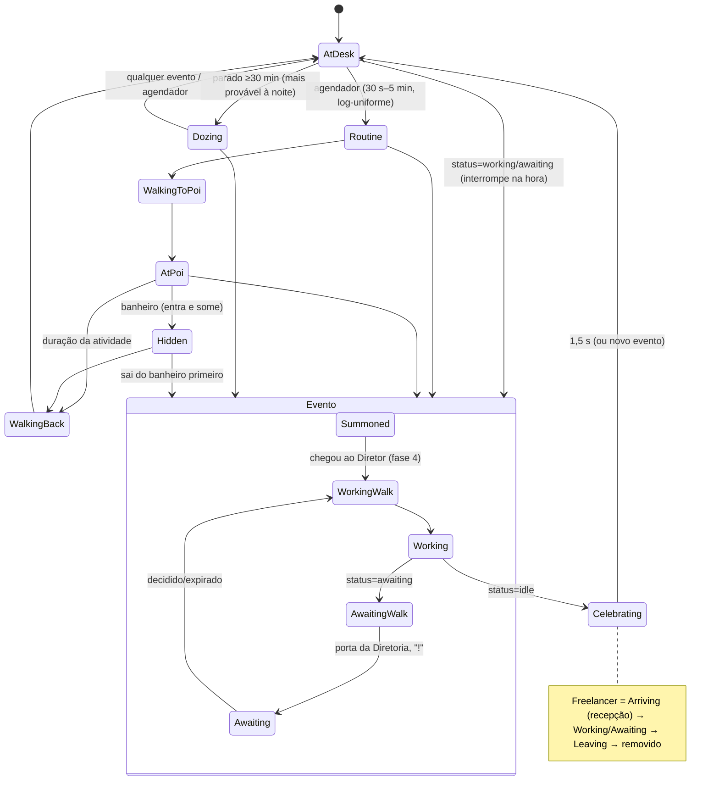

# Arquitetura — Escritório da Equipe

> Autor: Artur (arquiteto) · Data: 2026-11-12 · Status: **proposta, aguardando aprovação do Carlos**
> Entradas: `docs/projeto/2026-11-12-escritorio-equipe/{PEDIDO,PESQUISA,REQUISITOS}.md`. Decisões em `docs/adr/0001…0008`. Tarefas em `docs/projeto/2026-11-12-escritorio-equipe/TAREFAS.md`.
> Convenção: **[F]** fato verificado (fonte ou inspeção) · **[I]** inferência · **[S-xx]** precisa de spike · **[C]** depende do Carlos.
> Documento interno em pt-BR. A versão de usuário (en/pt-BR, Diátaxis "explanation") será derivada pelo Davi (T-38).

## 1. Visão geral

Um servidor Node local (`127.0.0.1:3200`) recebe eventos do Claude Code (hooks + leitura dos JSONL), lê os arquivos da equipe e dos projetos, controla as sessões de chat (PTY) e publica um **estado do escritório** por WebSocket para uma SPA React que desenha o andar em Canvas 2D e a HUD em DOM.

```mermaid
flowchart LR
  subgraph Claude["Claude Code (oficial)"]
    D[Claude Desktop<br/>sessões externas]
    P[claude --agent chefe<br/>sessões do painel]
    SL[statusLine]
  end
  subgraph Home["Arquivos locais"]
    J[(~/.claude/projects/**.jsonl)]
    E[(~/.claude/equipe/escritorio.json<br/>QUADRO.md)]
    U[(~/.claude/equipe/uso.json)]
    PL[(7 - DEV/*/docs/projeto/*/PLANO.md)]
    EH[(~/.escritorio-equipe/<br/>tokens, state, cache, logs)]
  end
  H[escritorio-hook.cjs] -->|POST Bearer hook-token| S
  S2[escritorio-statusline.cjs] --> U
  D -- hooks (Nível 1) --> H
  P -- hooks via --settings --> H
  SL --> S2
  D -. escreve .-> J
  P -. escreve .-> J
  subgraph S["Servidor (Fastify, 127.0.0.1:3200)"]
    ING[HookIngest] --> BUS((EventBus))
    JW[JsonlWatcher] --> BUS
    BUS --> OS[OfficeState]
    BUS --> AB[ApprovalBroker]
    TR[TeamRegistry] --> OS
    PW[PlanWatcher] --> OS
    UW[UsageWatcher] --> OS
    TA[TokenAggregator] --> OS
    SM[SessionManager<br/>PtyDriver / PrintDriver] --> P
    PC[ProjectCatalog + PathJail] --> SM
    OS --> WS[WS Hub]
    AUTH[Auth / CSRF / Host-Origin] --- WS
  end
  J --> JW & TA
  E --> TR
  U --> UW
  PL --> PW
  S --- EH
  WS <--> B
  subgraph B["Navegador (SPA)"]
    ST[Store] --> ENG[Motor Canvas 2D<br/>simulação dos NPCs]
    ST --> HUD[HUD React<br/>chat, aprovações, kanban, medidor]
    XT[xterm.js] 
  end
  L[abrir-escritorio .bat → escritorio open] -->|ticket| AUTH
```

Princípios: (1) zero tokens gastos pelo escritório; (2) nada muda no `settings.json` sem diff + OK; (3) o navegador nunca manda caminhos nem comandos; (4) parsers tolerantes com fixtures; (5) simulação dos NPCs é código puro e testável.

## 2. Stack e versões (ADR-0007)

| Camada | Escolha | Versão fixada |
|---|---|---|
| Runtime | Node LTS | 26.x (Carlos: 26.13.1 [F]) |
| Servidor | Fastify + @fastify/websocket, static, cookie, rate-limit | 5.12.8 · 11.3.7 · 10.1.10 · 11.1.5 · 11.2.2 |
| Contratos | zod (→ JSON Schema) | 4.6.7 |
| PTY | @lydell/node-pty **ou** node-pty | 1.2.0-beta.18 / 1.1.0 — **[S-01]** |
| Web | React + Vite + plugin-react | 19.3.1 · 8.3.8 · 6.3.0 |
| Render | Canvas 2D próprio (PixiJS 8.23.0 reserva) | **[S-02]** |
| Terminal | @xterm/xterm + addon-fit | 6.0.0 · 0.11.0 |
| Markdown | marked + dompurify | 18.2.0 · 3.4.17 |
| Linguagem | TypeScript | 6.0.3 (TS 7 não suportado pelo typescript-eslint 8.72.2 [F]) |
| Qualidade | ESLint · typescript-eslint · Prettier | 10.14.0 · 8.72.2 · 3.10.1 |
| Testes | Vitest · Playwright (Edge instalado, `channel:'msedge'`) | 5.1.0 · 1.65.0 |
| Build | esbuild (servidor) · Vite (web) · tsx (dev) | 0.28.2 · 8.3.8 · 4.23.15 |

Versões consultadas no registro npm em 2026-11-12 [F]. Pin exato no `package.json` + `package-lock.json` versionado.

## 3. Estrutura do repositório

```
escritorio-equipe/
├─ CLAUDE.md · README.md · README.pt-BR.md · CHANGELOG.md · CHANGELOG.pt-BR.md
├─ LICENSE (MIT: Pablo De Lucca + Carlos) · NOTICE.md · NOTICE.pt-BR.md · CREDITS.md · CREDITS.pt-BR.md
├─ package.json · package-lock.json · .npmrc · .nvmrc · .env.example · .gitignore · .gitattributes · .editorconfig
├─ tsconfig.base.json · tsconfig.server.json · tsconfig.web.json · vite.config.ts · vitest.config.ts
├─ playwright.config.ts · eslint.config.js · .prettierrc.json
├─ src/
│  ├─ shared/                 # TS puro, sem I/O; usado por servidor, web e testes
│  │  ├─ contracts/           # zod: hook payload, OfficeEvent, WS msgs, REST DTOs, uso, escritorio, mapa
│  │  ├─ plan/                # parser de PLANO.md/TAREFAS.md, mapeamento de status, fase/timeline
│  │  ├─ npc/                 # máquina de estados, agendador de rotina, regras anti-sincronia, ferramenta→animação
│  │  ├─ world/               # A*, grid, câmera (matemática), ciclo dia/noite, sazonais
│  │  ├─ usage/               # cores/limiares, contagem regressiva, arme de alertas
│  │  ├─ text/                # mascaramento de segredos, truncamento, validação de nome de projeto
│  │  └─ rng.ts · time.ts     # RNG com semente; relógio America/Sao_Paulo
│  ├─ server/
│  │  ├─ main.ts · app.ts     # bootstrap, Fastify, encerramento limpo
│  │  ├─ config/ · home/      # ~/.escritorio-equipe, tokens, ACL, runtime.json
│  │  ├─ http/                # auth (ticket/cookie/CSRF), host-origin guard, headers, rotas REST
│  │  ├─ ws/                  # hub, batch, canal de terminal
│  │  ├─ ingest/              # rota de hooks, normalizador, dedupe, EventBus
│  │  ├─ jsonl/               # tail incremental, fallback de eventos, transcript do chat
│  │  ├─ office/              # OfficeState, atividade, salas de projeto
│  │  ├─ team/                # TeamRegistry (escritorio.json + QUADRO.md)
│  │  ├─ approvals/           # ApprovalBroker
│  │  ├─ sessions/            # SessionManager, PtyDriver, PrintDriver, resolução do claude.exe
│  │  ├─ projects/            # ProjectCatalog, PathJail, PlanWatcher, GitInfo
│  │  ├─ usage/ · tokens/     # UsageWatcher, TokenAggregator
│  │  ├─ settings-installer/  # diff/apply/revert do ~/.claude/settings.json
│  │  └─ log/                 # pino + redação
│  ├─ cli/escritorio.ts       # start | open | stop | status | token:rotate | settings:* | team:*
│  ├─ hook-runtime/           # JS puro sem deps, sem build: escritorio-hook.cjs, escritorio-statusline.cjs
│  └─ web/
│     ├─ main.tsx · App.tsx
│     ├─ store/ · net/        # store + WS com reconexão + REST com CSRF
│     ├─ i18n/                # pt-BR.json (fonte das chaves), en.json, t()
│     ├─ engine/              # loop, renderer, camera, sprites, iluminação, partículas, picking, minimapa
│     ├─ hud/                 # topbar, gavetas, chat, inbox, atividade, kanban, medidor, cartões NPC, créditos
│     └─ styles/              # tokens do guia visual (CSS vars)
├─ assets/                    # map/mapa.json, tilesets/, sprites/, fonts/ (OFL), sfx/, music/, phrases/ (só arte redistribuível)
├─ assets-private/            # (gitignored) arte paga sem direito de redistribuição (ex.: Modern Interiors, ASSETS.md da Bianca); o carregador sobrepõe assets/ por id
├─ schemas/                   # JSON Schemas gerados (escritorio.v1, mapa.v1, uso.v1, events.v1)
├─ scripts/                   # dev.mjs, abrir-escritorio-dev.bat, perf/measure-cpu.ps1, check-credits.mjs
├─ tests/
│  ├─ fixtures/               # hooks/, jsonl/, plano/, statusline/, escritorio/, mapa/ (anonimizados)
│  ├─ integration/            # servidor real em porta aleatória + HOME temporário
│  └─ e2e/                    # Playwright (Edge)
├─ spikes/                    # protótipos S-01..S-05 (removidos do main antes do PR da fase 1, ficam na branch spike/*)
├─ third_party/pixel-agents/LICENSE
└─ docs/ adr/ · en/ · pt-BR/ · design/ (Bianca) · projeto/ · ARQUITETURA.md
```
Testes unitários ficam ao lado do código (`*.test.ts`). Cada teste cita os CAs no nome: `it('CA-16: two starts keep working until last stop', …)`.

## 4. Fluxos principais

### 4.1 Agente chamado → NPC trabalha (CA-15, CA-16, M-05)
```mermaid
sequenceDiagram
  participant CC as Claude Code
  participant HK as escritorio-hook.cjs
  participant SV as Servidor
  participant WB as Navegador
  CC->>HK: SubagentStart {agent_type:"dev-web", agent_id, cwd, session_id}
  HK->>SV: POST /api/hooks/v1/claude (Bearer hook-token, ≤1 s)
  SV->>SV: normaliza → OfficeEvent; dedupe; TeamRegistry resolve "dev-web" → Lívia
  SV->>SV: OfficeState: Lívia.active[agent_id] = {project:"Sites"} → status=working
  SV-->>WB: WS batch (≤100 ms): npc.update + activity
  WB->>WB: FSM: Idle → Working(walk to desk/room) ; ícone ⚙
  CC->>HK: SubagentStop {agent_id}
  HK->>SV: POST …
  SV-->>WB: npc.update (activeCount 0) → Celebrating → Idle
```
Sem hooks (Nível 0 para sessões externas): o JsonlWatcher detecta `subagents/agent-<id>.jsonl` + `.meta.json` e emite os mesmos eventos com `source:"jsonl"` (atraso esperado 1–2 s **[S-03]**).

### 4.2 Aprovação (CA-37…CA-40, M-06)
```mermaid
sequenceDiagram
  participant CC as Claude Code
  participant HK as hook (PermissionRequest)
  participant AB as ApprovalBroker
  participant WB as Navegador
  CC->>HK: stdin {tool_name, tool_input, session_id,…}
  HK->>AB: POST /api/hooks/v1/approvals (≤1 s) 
  AB-->>HK: 201 {id, deadline}
  AB-->>WB: approval.upsert (resumo mascarado) + som + Notification
  HK->>AB: GET /api/hooks/v1/approvals/{id}/wait (long-poll até deadline)
  WB->>AB: POST /api/approvals/{id}/decision {allow} (cookie+Origin+CSRF)
  AB-->>HK: 200 {behavior:"allow"}
  HK-->>CC: stdout {"hookSpecificOutput":{"hookEventName":"PermissionRequest","decision":{"behavior":"allow"}}}
  Note over AB,HK: timeout → 204 → hook sai 0 sem stdout → fluxo normal; cartão "expirado — decida no terminal"
```
Regras: primeira decisão vence (compare-and-set); decisão após prazo → 409; id = 128 bits aleatórios; vínculo com `session_id` + hash do `tool_input`; se o servidor reiniciar, aprovações pendentes somem e o hook recebe erro → fluxo normal. Aprovação de plano: se `ExitPlanMode` chegar por PermissionRequest **[S-03]**, o cartão mostra o plano (markdown sanitizado); senão, só notificação (CA-41).

### 4.3 Chat no modo interativo (CA-32, CA-36, ADR-0003)
1. `POST /api/chat/sessions {projectName, resumeSessionId?}` → PathJail valida → SessionManager cria uuid → `PtyDriver.spawn(claudeExe, ["--agent","chefe","--session-id",uuid, "--settings", file?], {cwd})`.
2. `POST /api/chat/sessions/:id/messages {text}` → fila; quando `idle` (hook `Stop`/início), escreve `ESC[200~text ESC[201~\r`.
3. Transcript `~/.claude/projects/<slug>/<uuid>.jsonl` é seguido; cada linha nova vira `chat.items` (assistente: markdown; ferramenta: cartão compacto; usuário: eco).
4. Aba Terminal: `/ws/terminal/:id` envia bytes do PTY (somente leitura por padrão).
5. Encerrar: `DELETE` → envia `/exit`, espera 3 s, mata a árvore de processos.

### 4.4 Abertura pelo atalho (CA-83, CA-84, ADR-0005)
`abrir-escritorio.bat` → `node dist/cli.js open` → lê `runtime.json`/token → `GET /api/health` (Bearer) → se desligado, inicia `node dist/server/index.js` destacado (janela oculta, log em arquivo) e espera saudável (≤20 s) → `POST /api/auth/ticket` → abre `http://127.0.0.1:3200/auth/callback?ticket=…` no navegador padrão.

## 5. Contratos

Todos definidos em zod em `src/shared/contracts/` e exportados como JSON Schema em `schemas/`. Versão do protocolo: `v: 1`. Campos desconhecidos são **aceitos e ignorados** (tolerância), exceto nas rotas de ação, que são **estritas**.

### 5.1 Entrada de hooks (`POST /api/hooks/v1/claude`)
Corpo = payload bruto do Claude Code. Campos usados (todos opcionais exceto `hook_event_name`):
```ts
{ hook_event_name: string; session_id?: string; transcript_path?: string; cwd?: string;
  permission_mode?: string; agent_id?: string; agent_type?: string;
  tool_name?: string; tool_use_id?: string; tool_input?: unknown;      // tool_input NUNCA logado/persistido
  notification_type?: string; last_assistant_message?: unknown;        // ignorado (privacidade)
  task?: unknown /* formato [S-03] */ }
```
Resposta: `204` (observacional). Erros de schema → `202` + contador `ingest.invalid` (nunca 4xx que faça o hook logar conteúdo).

### 5.2 Evento normalizado (`OfficeEvent`, interno e no feed)
```ts
type ProjectRef = { kind: "dev"; name: string } | { kind: "outside"; basename: string } | { kind: "unknown" };
type ToolCategory = "edit" | "read" | "bash" | "web" | "delegate" | "task" | "plan" | "other";
interface OfficeEvent {
  v: 1; id: string; ts: number; source: "hook" | "jsonl" | "panel" | "system";
  kind: "session.start" | "session.end" | "prompt.submit" | "turn.stop" | "tool.pre" | "tool.post" | "tool.fail"
      | "subagent.start" | "subagent.stop" | "permission.request" | "notification" | "task.created" | "task.completed";
  sessionId: string | null; project: ProjectRef;
  agent: { agentType: string | null /* null = thread principal → chefe */; agentId: string | null };
  tool?: { name: string; category: ToolCategory; useId?: string };
  notificationType?: string;
  task?: { ref?: string /* "T-12" se casar */; subject?: string /* ≤120, mascarado */ };
}
```
Mapa ferramenta → categoria: `Edit|Write|MultiEdit|NotebookEdit`→edit · `Read|Grep|Glob|LS`→read · `Bash|PowerShell`→bash · `WebFetch|WebSearch`→web · `Agent|Task`→delegate · `TaskCreate|TaskUpdate|TaskList|TaskGet|TodoWrite`→task · `ExitPlanMode|EnterPlanMode`→plan · resto (inclui `mcp__*`)→other.

### 5.3 Estado do escritório (snapshot e atualizações)
```ts
interface NpcLogical {
  key: string;                    // agentType (fixo) ou "freelancer:<agentId>"
  kind: "fixed" | "freelancer";
  agentType: string; displayName: string;
  status: "idle" | "working" | "awaiting";
  activeCount: number;            // instâncias paralelas (CA-16)
  since: number;                  // início do status atual (para "há quanto tempo")
  project?: ProjectRef; taskRef?: string; taskTitle?: string;
  tool?: ToolCategory; approvalIds: string[]; lastEventAt?: number;
}
interface ApprovalCard {
  id: string; createdAt: number; deadline: number;
  state: "pending" | "allowed" | "denied" | "expired" | "answered";
  sessionId: string; npcKey: string; project: ProjectRef; toolName: string;
  summary: string;                // ≤200 chars, mascarado; detalhes via GET /api/approvals/:id/details
  kind: "tool" | "plan";
}
interface ProjectSummary {
  name: string; active: boolean; lastActivityAt?: number; roomSlot?: 0|1|2|3;
  plan?: { size?: "P"|"M"|"G"; phase?: TimelineStep; progress: number | null; counts: Record<KanbanColumn, number>;
           diagnostics: PlanDiagnostic[] };
}
interface OfficeSnapshot {
  v: 1; now: number; team: TeamView; npcs: NpcLogical[]; approvals: ApprovalCard[];
  projects: ProjectSummary[]; overflowProjects: string[]; usage: UsageView | null;
  activity: ActivityItem[]; /* últimos 200 */ config: PublicConfig; diagnostics: Diagnostic[];
}
```

### 5.4 WebSocket `/ws` (servidor → cliente)
Mensagens agrupadas a cada ≤100 ms em `{t:"batch", items:[…]}`:
`hello` · `snapshot` · `npc.update` · `activity` · `approval.upsert` · `approval.remove` · `project.upsert` · `rooms` · `plan.update` · `usage` · `tokens` · `team` · `chat.session` · `chat.items` · `alert` · `diag`.
Cliente → servidor: só `{t:"ping"}`. Reconexão com backoff (1 s → 30 s) e `snapshot` completo a cada conexão.
`/ws/terminal/:sessionId`: binário (saída PTY); entrada aceita só com "permitir entrada" ligado: `{t:"input", data}` (≤4 kB) e `{t:"resize", cols, rows}`.

### 5.5 REST (todas exigem cookie `esc_sid`; ações exigem também `Origin` + `X-Escritorio-CSRF`)
| Método e rota | Uso | Fase | CAs |
|---|---|---|---|
| `GET /auth/callback?ticket=` | troca ticket por cookie, 303 → `/` | 1 | 03 |
| `POST /api/auth/ticket` | (Bearer token; sem Origin) emite ticket | 1 | 03, 84 |
| `GET /api/health` | (Bearer ou cookie) `{ok, version}` | 1 | 83 |
| `GET /api/session` | CSRF token, idioma | 1 | 30 |
| `GET /api/state` | `OfficeSnapshot` | 1 | 12, 19 |
| `GET /api/npcs/:key/history` | ≥10 últimas atividades (metadados) | 1 | 19 |
| `GET/PATCH /api/config` | lista fechada (lang, sound, music, quality, approvalDeadlineSec, chatMode por projeto, npcWorkPlace) | 1–4 | 10, 31 |
| `GET /api/projects` · `POST /api/projects {name}` | lista/cria em 7 - DEV | 2 | 27, 28, 29 |
| `GET /api/projects/:name/sessions` | histórico (id, data, título, nº msgs) | 2 | 36 |
| `POST /api/chat/sessions {projectName, resumeSessionId?, mode?}` | abre/retoma | 2 | 32, 34, 36 |
| `POST /api/chat/sessions/:id/messages {text}` · `DELETE /api/chat/sessions/:id` | envia / encerra | 2 | 32, 45 |
| `POST /api/chat/sessions/:id/terminal-input {enabled}` | liga entrada | 2 | 33 |
| `GET /api/approvals/:id/details` · `POST /api/approvals/:id/decision {behavior:"allow"\|"deny", message?}` | detalhes / decisão | 2 | 37–40 |
| `POST /api/hooks/v1/claude` · `POST /api/hooks/v1/approvals` · `GET /api/hooks/v1/approvals/:id/wait` | só hook-token, sem Origin | 1–2 | 15, 37–39 |
| `GET /api/projects/:name/plan` | `PlanModel` completo | 3 | 48–53 |
| `GET /api/usage` · `GET /api/tokens?group=project\|agent\|day&days=14` | medidor / tokens | 3 | 56–64 |
| `GET /api/diag` | contadores (sem conteúdo) | 1 | — |

Limites: corpo ≤64 kB (hooks ≤1 MB), mensagem de chat ≤32 kB, rate limit geral 120 req/min, ações 30/min.

### 5.6 Configuração do Claude por sessão do painel (`--settings`)
`~/.escritorio-equipe/claude-settings.json` gerado pelo servidor: `hooks` (se o Nível 1 não estiver instalado) + `statusLine` (nosso script, envolvendo o do usuário se existir). **[S-03]** confirma a mesclagem.

## 6. Máquina de estados dos NPCs

Duas camadas: **status lógico** (servidor, a partir de eventos — fonte da verdade) e **comportamento** (cliente, simulação visual com RNG de semente — pura em `src/shared/npc/`, testada sem navegador).

### 6.1 Status lógico (servidor)
- `working` se `activeCount > 0` (Start incrementa por `agent_id`, Stop decrementa; Stop sem Start é ignorado; instância sem eventos por 15 min expira com aviso). Thread principal (`agent_type` ausente) → **chefe**: `working` entre `prompt.submit` e `turn.stop`; "sessão ativa" se há evento nos últimos 10 min.
- `awaiting` se há aprovação pendente ligada à sessão/agente (prioridade sobre `working`, pois o agente está de fato parado esperando). No mapa: posição livre mais próxima da porta na fila `FILA-1…8` (MAPA.md §4); excedente espera na mesa com "!".
- `idle` caso contrário.
- `agent_type` desconhecido → NPC `freelancer:<agent_id>` (criado no Start, removido 5 s após o Stop) (CA-17).

### 6.2 Comportamento (cliente)

**Prioridades** (preempção): `Awaiting` > `Working` > `Summoned` > `Celebrating` > rotina. *Observação:* o briefing listou "trabalhando > aguardando aprovação"; inverti porque um agente com aprovação pendente está **bloqueado** e o CA-71/CA-72 exigem que ele vá à porta da Diretoria com "!" (ícone `!` > `⚙`). Rotina nunca preempta evento.

**Lugar de trabalho** (CA-69, PA-15): padrão `desk`; `projectRoom` quando o projeto tem sala atribuída e ≥2 agentes ativos há >2 min (configurável `npcWorkPlace: desk|projectRoom|auto`, padrão `auto` na fase 4, `desk` nas fases 1–3).

**Ferramenta → animação:** edit→`typing` · read→`reading` · bash→`terminal` (mini-terminal brilhando) · web→`research` (livro) · delegate→`talking` (chefe; dispara balão "<Apelido>, preciso de você!" na fase 4) · task/plan→`writing` · other/sem evento→`working-generic`.

**Anti-sincronia (CA-65):**
1. RNG por NPC com semente `hash(agentType) ⊕ diaJuliano` (determinístico nos testes; `?seed=` em debug).
2. Primeira decisão desencontrada (0–60 s após carregar); intervalos log-uniformes 30 s–5 min; duração por atividade com faixa própria.
3. "Diretor de atividades" global: recusa uma escolha se > 40 % dos NPCs ociosos já estiverem na mesma atividade/local; respeita capacidade de cada POI (`capacity` no mapa).
4. Cooldown: o mesmo NPC não repete a mesma atividade em 2 decisões seguidas.
5. Pesos por personalidade (`escritorio.json` → `personality.routineWeights`), e por horário (bocejo/cochilo ×3 após 22h).
6. Conversa = par formado na copa/corredor; no máximo 2 conversas simultâneas; balões em fila sem sobreposição.

**Retomada após aba oculta (CA-07):** o loop para; ao voltar, `dt` é limitado a 100 ms; NPCs cujo status lógico mudou enquanto oculto **vão direto** ao destino (snap) para refletir o estado real sem "teleporte animado"; rotina reinicia o agendador.
**Movimento reduzido (CA-22):** caminhada substituída por troca de pose no destino (snap com fade de 150 ms ou sem fade), partículas/chuva/mascotes correndo desligados.

## 7. Mundo: mapa, pathfinding, câmera

### 7.1 Contrato `assets/map/mapa.json` (`mapa/v1`) — o MAPA.md da Bianca é convertido para ele
O `docs/design/MAPA.md` (2026-11-12) é a fonte: andar **64×52** tiles (1024×832 px a 1×, ajuste da Bianca sobre os ~60×40 do pedido — [C] confirmar), ids de sala (`DIR`, `REU`, `PLN`, `ENG`, `QUA`, `SOC`, `PRJ1…4`, `ENT`, `SRV`, `BIB`, `REC`, `WC`, `COP`, `TER`, corredores `COR1…3`, `PAS1/2`), portas (`DR-*`), assentos (`DIR-00`, `PLN-01`…, vagas `<SALA>-Vn`, provisórias `FL-D1/2`, sofá `FL-S1/2`, reunião `REU-01…14`, projeto `PRJn-1…6`), fila de aprovação `FILA-1…8`, POIs (`POI-*`), janelas e zonas de luz (`ZL-*`). O conversor (T-22) mantém esses ids sem alteração.
```jsonc
{
  "schema": "mapa/v1",
  "tileSize": 16, "cols": 64, "rows": 52,
  "tilesets": [{ "id": "interior", "image": "tilesets/interior.png", "columns": 32, "license": "CREDITS#interior" }],
  "layers": { "floor": [/* cols*rows ids */], "walls": [], "decorBelow": [], "decorAbove": [] },
  "collision": "base64 bitset cols*rows (1 = bloqueado)",
  "rooms": [{ "id": "DIR", "kind": "diretoria", "department": "diretoria", "nameKey": "room.DIR",
              "rects": [[x1,y1,x2,y2]], "faceRows": 2, "doors": ["DR-DIR"], "lightZone": "ZL-DIR", "camera": [9,6] }],
  "doors": [{ "id": "DR-DIR", "tiles": [[8,11],[9,11]], "connects": ["DIR","COR1"] }],
  "desks": [{ "id": "PLN-01", "room": "PLN", "department": "planejamento", "seat": [45,5], "facing": "south",
              "table": [44,6,46,7], "vacancy": false, "decor": ["postits"] }],
  "seats": [{ "id": "REU-01", "room": "REU", "tile": [24,5], "facing": "south", "kind": "meeting|project|sofa|provisional|visitor" }],
  "pois": [{ "id": "POI-CAFE", "kind": "coffee", "room": "COP", "tiles": [[x,y]], "facing": "north",
             "capacity": 2, "activity": "coffee", "durationSec": [20, 90] }],
  "objects": [{ "id": "cafeteira", "sprite": "props/coffee", "tile": [x,y], "footprint": [w,h],
               "anim": "steam", "light": null }],
  "lightZones": [{ "id": "ZL-PRJ1", "rooms": ["PRJ1"], "mode": "activity|night|always" }],
  "lights": [{ "id": "abajur-bib", "zone": "ZL-BIB", "tile": [61,35], "sprite": "light/warm-48", "color": "#ffd9a0" }],
  "windows": [{ "id": "JAN-DIR", "room": "DIR", "rect": [6,1,12,2], "view": "city|garden|sky" }],
  "boards": [{ "id": "metas-do-mes", "room": "DIR", "kind": "metas", "rect": [13,1,16,2] },
             { "id": "bugs", "kind": "bugs" }, { "id": "branches", "kind": "git-branches" },
             { "id": "tv-reuniao", "kind": "tv-kanban" }, { "id": "recepcao-projetos", "kind": "active-projects" }],
  "projectSlots": [{ "slot": 0, "room": "PRJ1", "doorSign": [x1,y1,x2,y2], "board": [x1,y1,x2,y2],
                     "progressBar": [x1,y1,x2,y2], "seats": ["PRJ1-1","PRJ1-2","PRJ1-3","PRJ1-4","PRJ1-5","PRJ1-6"] }],
  "spawn": { "entrance": "DR-ENTRADA", "receptionCounter": [8,47], "approvalQueue": ["FILA-1","…","FILA-8"],
             "provisionalDesks": ["FL-D1","FL-D2"], "freelancerSofa": ["FL-S1","FL-S2"] },
  "pets": { "beds": { "pacoca": [27,49], "biscoito": [29,49] }, "forbiddenRooms": ["SOC","PRJ1","PRJ2","PRJ3","PRJ4"] }
}
```
Retângulos em coordenadas inclusivas `[x1,y1,x2,y2]` como no MAPA.md. Regras de validação: ids únicos; todo assento/POI/fila em tile caminhável alcançável a partir de `DR-ENTRADA` (BFS); as 2 linhas de face norte de cada sala bloqueadas; 4 `projectSlots`; todas as salas do CA-11 presentes; ≤8 posições na fila (excedente espera na mesa com "!", MAPA.md §4).

### 7.2 Pathfinding
A* 4 direções no grid 64×52 (3.328 células; heurística Manhattan; heap binário) em `src/shared/world/pathfinding.ts`; cache LRU de caminhos (mesa↔POI); portas são tiles caminháveis; NPCs não colidem entre si (passam um pelo outro, como no Pixel Agents), mas **assentos e POIs são reservados**. Velocidade 48 px/s (~3 tiles/s). Mascotes usam o mesmo grid com velocidade 32 px/s e recálculo a cada 1 s ao seguir.

### 7.3 Câmera
- Escala de tela = inteiro de **pixels do dispositivo** por pixel de arte (`s ∈ {2,3,4,…}`), escolhida para que `s / devicePixelRatio` fique próximo de 2×/3×/4×; o canvas é dimensionado em pixels do dispositivo → nitidez em 125 %/150 %.
- Pan por arrasto e teclas; zoom pelo scroll ancorado no cursor; limites do mapa; "seguir NPC" com lerp 0,1 e posição arredondada ao pixel de arte; Esc ou arrasto solta.
- Minimapa: estático pré-renderizado a 1/4 + pontos coloridos por departamento, redesenhado a 2 fps; clique centraliza.
- Gaveta de projetos → `centerOnRoom(roomId)` usando o ponto `camera` da sala (MAPA.md §2).

### 7.4 Ciclo dia/noite e sazonais
Relógio sempre `America/Sao_Paulo` (`Intl.DateTimeFormat` com `timeZone`). Faixas e cores: as do `docs/design/GUIA-VISUAL.md` (quatro tons com mistura linear de 30 min nas fronteiras; a luz tinge só o canvas, nunca a HUD). Ambiente = interpolação de cor entre âncoras a cada 60 s (não por frame). Sazonais por data (dez, jun, fev, aniversário de projeto) mudam o conjunto de decorações e reconstroem a camada estática uma vez. `?debugTime=2026-12-24T21:00` e `?debugDate=` simulam (CA-74, CA-75).

## 8. Contrato de leitura do PLANO.md (parser do painel)

Parser puro: `parsePlan(markdown: string, opts) → PlanModel` + `diagnostics[]` (nunca lança).
1. **Cabeçalho:** primeira tabela `Campo | Valor`. Linhas lidas (acento/maiúsculas ignorados): `Tamanho` (P/M/G), `Status` (`Rascunho`, `Aguardando aprovação`, `Aprovado em AAAA-MM-DD`, `Em execução`, `Concluído`), **`Fase`** (novo, ver ajustes), `Repositório / pasta`.
2. **Tarefas:** toda tabela GFM dentro da seção cujo título casa `^##\s*(\d+\.\s*)?Tarefas` (até o próximo `## `) **e** toda tabela de `TAREFAS.md` na mesma pasta, desde que o cabeçalho contenha `ID` e `Status`. Colunas por **nome** (ordem livre; extras ignoradas): `ID`; `Tarefa|Título|Descrição`; `Responsável|Dono`; `Depende de|Dependências`; `Arquivos`; `CAs|CA`; `Tam.|Tamanho`; `Status`; `Fase` (opcional — senão herdada do `###` mais próximo com "Fase N" ou "Spike"). ID válido: `^(T|S)-\d{2,3}[a-z]?$`.
3. **Status → coluna do kanban** (PA-03), após remover acentos e caixa; o emoji pode vir seguido de texto:

| Coluna | Aceita |
|---|---|
| A fazer | `⬜`, vazio, `a fazer`, `pendente`, `todo` |
| Em andamento | `🔄`, `em andamento`, `fazendo`, `doing`, `wip` |
| Em revisão | `🔍`, `👀`, `em revisao`, `revisao`, `review` |
| Concluída | `✅`, `concluida`, `concluido`, `feita`, `feito`, `done`, `[x]` |
| Bloqueada | `⚠️`, `⚠`, `bloqueada`, `bloqueado`, `blocked` |
| *(excluída do total)* | `❌`, `cancelada`, `removida`, linha inteira tachada `~~…~~` (PA-04) |
| A fazer + selo "status não reconhecido" | qualquer outro valor |

4. **Responsável:** resolve por `agentType` (`dev-web`), apelido (`Lívia`) ou "nome (apelido)"; vários separados por `+`, `,` ou `/` → o primeiro é o dono, os demais "apoio"; desconhecido → rosto de Freelancer (CA-51).
5. **Checklists:** itens `- [ ]`/`- [x]` sob `Entregáveis`, `Definition of Done`, `Checklist de entrega` (CA-53).
6. **Progresso:** `round(concluídas / (total − canceladas) × 100)`; denominador 0 → `null` ("—") (CA-50).
7. **Linha do tempo** (PA-12): `Fase` do cabeçalho mapeada para `planejado | aprovado | construcao | qualidade | docs | pr-pronto` (aceita os nomes das fases do modelo); sem o campo → dedução: sem PLANO → planejado; `Status` sem "Aprovado em" → planejado; aprovado e nenhuma tarefa iniciada → aprovado; tarefas em andamento de devs → construção; só tarefas de QA/revisão/pentest abertas → qualidade; só documentador/git abertas → docs; tudo concluído e `PR.md` presente → PR pronto. **Projeto concluído** = 100 % e DoD todo marcado (dispara a comemoração uma vez, CA-55).
8. **Robustez:** linhas malformadas viram diagnóstico `{line, message}`; arquivo em gravação (parse falha ou tamanho muda durante a leitura) → re-tenta após 300 ms e mantém o último modelo válido (CA-49).

### 8.1 Ajustes propostos ao `modelo-plano.md` (precisam do OK do chefe/Carlos)
1. Legenda de status: acrescentar **`🔍 em revisão`** e **`❌ cancelada`** (hoje só ⬜ 🔄 ✅ ⚠️; sem "em revisão" o kanban nunca preenche essa coluna).
2. Cabeçalho: nova linha **`| Fase | Planejamento · Aprovado · Construção · Qualidade · Documentação · PR pronto · Concluído |`** (projetos G podem acrescentar "— fase 2/5").
3. Coluna `Responsável` com o **nome técnico** do agente (`dev-web`), apelido opcional entre parênteses.
4. Permitir várias tabelas de tarefas sob `## 5. Tarefas` (uma por fase, com `### Fase N`) e o arquivo irmão `TAREFAS.md`; colunas extras (`Tam.`, `Validação`) são permitidas.
5. Registrar que o painel lê o PLANO.md: não renomear as seções `Tarefas`, `Entregáveis`, `Definition of Done`, `Checklist de entrega`.

## 9. Internacionalização
- `src/web/i18n/pt-BR.json` é a fonte das chaves (tipos gerados por `resolveJsonModule`); `en.json` deve ter o mesmo conjunto — teste de paridade falha se faltar/sobrar chave (CA-10). `t(key, params)` com `Intl.PluralRules`; datas/números com `Intl.*` no idioma escolhido; **relógio e ciclo dia/noite sempre em `America/Sao_Paulo`**.
- Troca de idioma sem recarregar (store) e persistência em `config.json` (+ `localStorage` para o primeiro paint).
- Falas dos NPCs: pt-BR em `escritorio.json` (en = Could, PA-21). Textos vindos de dados (nomes de pasta, títulos de tarefa) nunca passam por tradução.
- Proibido texto de interface fixo em componentes (regra de lint `no-literal-string` restrita a `src/web/hud/**`).

## 10. Execução no Windows

| Script npm | O que faz |
|---|---|
| `dev` | `scripts/dev.mjs`: `vite build --watch` + `tsx watch src/server/main.ts` (porta 3200) |
| `build` | `vite build` → `dist/web` · esbuild → `dist/server/index.js`, `dist/cli.js` |
| `start` | `node dist/server/index.js` (primeiro plano) |
| `open` / `stop` / `status` | `node dist/cli.js open|stop|status` |
| `test` · `test:unit` · `test:int` · `test:e2e` | Vitest unit / integração; Playwright (Edge) |
| `lint` · `typecheck` · `format` · `check` | ESLint · `tsc -p` (server e web) · Prettier · tudo junto |
| `schemas:gen` | zod → `schemas/*.json` |
| `settings:diff` · `settings:apply` · `settings:revert` | ADR-0004 |
| `hooks:sync` | copia `src/hook-runtime/*.cjs` para `~/.escritorio-equipe/bin/` (com hash) |
| `token:rotate` · `team:check` · `team:init` | ADR-0005 · consistência QUADRO×escritorio · cria escritorio.json a partir da proposta aprovada |
| `credits:check` | todo arquivo em `assets/` tem entrada no CREDITS |

`scripts/abrir-escritorio-dev.bat`: `cd /d "%~dp0.."` → `npm run build` se `dist` não existir → `node dist\cli.js open`. Mesma lógica do `.bat` atual (liga se desligado, senão só abre), sem token na URL. O `C:\Users\carlo\pixel-agents\abrir-escritorio.bat`, o atalho e a inicialização do Windows **só mudam na fase 5** (T-90…).
Variáveis (`.env.example`, nenhuma secreta): `ESCRITORIO_PORT=3200`, `ESCRITORIO_HOME=%USERPROFILE%\.escritorio-equipe`, `ESCRITORIO_DEV_ROOT=C:\Users\carlo\OneDrive\Documentos\7 - DEV`, `ESCRITORIO_LOG_LEVEL=info`, `CLAUDE_BIN=` (caminho absoluto do `claude.exe`).

## 11. Estratégia de testes

| Camada | Ferramenta | O que cobre |
|---|---|---|
| Unit (shared) | Vitest/node | parser do PLANO, mapeamento de status, timeline; FSM e agendador (simulação de 30 min com semente); A*, conectividade do mapa; câmera; cores/limiares/contagem regressiva/arme de alertas; mascaramento; validação de nome de projeto; normalizador de eventos; regra do Freelancer; dedupe de tokens; schemas (fixtures válidas e inválidas); paridade i18n |
| Unit (scripts) | Vitest + child_process | `escritorio-hook.cjs` (servidor fora → sai 0 em ≤1,5 s sem stdout; decisão allow/deny; nunca allow em erro); `escritorio-statusline.cjs` (≤200 ms, escrita atômica, não sobrescreve bom com vazio, `--wrap`) |
| Integração | Vitest + Fastify real (127.0.0.1, porta aleatória, `HOME` temporário) | auth/ticket/cookie/CSRF/Origin/Host/WS; ingest → WS; aprovações com hook falso (timeout, duplo clique, pós-prazo); PathJail em FS real (junction `mklink /J`, `..`, UNC, 8.3, reservados); watchers (PLANO, uso.json, escritorio.json, JSONL) com escritas reais; SessionManager com **claude falso** (`tests/fixtures/fake-claude.mjs`, imita TUI + transcript) — zero tokens; instalador do settings.json em cópia temporária |
| E2E | Playwright (Edge, `--headless=new`) | login por ticket; HUD; hover ≤150 ms; i18n; reduced-motion; atalhos; aprovação ponta a ponta com hook simulado; chat com claude falso; kanban ao vivo; medidor com fixtures; viewport 390×844; teste de nitidez (paleta) em DPR 1, 1,25, 1,5; contador de quadros ≤30 |
| Manual documentado | roteiro + `scripts/perf/measure-cpu.ps1` (typeperf) | CPU M-02/M-03/M-04 (10 min); sessão real do Desktop (CA-18); sessão real do claude (marcada `@real`, fora do CI, consome tokens só com OK); inicialização do Windows (CA-84) |

Mapa CA → teste (a Teresa mantém a matriz completa em `docs/projeto/…/MATRIZ-CA.md`):

| CAs | Tipo principal |
|---|---|
| 01, 02, 03, 30, 31, 47 | integração (+ pentest) |
| 04 | script de hash (T-03) + verificação no fim de cada fase |
| 05, 82 | `credits:check` + revisão |
| 06, 07, 22, 23, 79, 80 | e2e |
| 08, 81 | manual (perf) + e2e de degradação |
| 09 | integração (spy em `child_process`/rede) + inspeção |
| 10 | unit (paridade) + e2e |
| 11, 12, 13, 17, 21 | unit (schemas, cruzamento, Freelancer) + integração (watch) |
| 14, 19, 54 | e2e |
| 15, 16, 69, 72 | unit (status lógico, FSM) + integração (ingest → WS) |
| 18, 44 | integração (JsonlWatcher com fixtures) + manual Desktop |
| 20, 59 | integração (instalador em cópia) |
| 24 | auditoria de contraste (Bianca) + teste automatizado das cores de token |
| 25, 89 | CI local `npm run check` |
| 26 | processo (gate) |
| 27, 28, 29 | unit + integração (FS real) |
| 32, 33, 34, 36, 45 | integração (claude falso) + e2e + manual real |
| 35 | gate (registro no PLANO) |
| 37–42 | unit + integração + e2e |
| 43 | unit (política de salas) + e2e |
| 46 | relatórios Sérgio + Pedro |
| 48–53, 55 | unit (parser) + integração (watcher) + e2e |
| 56, 57, 60, 61, 62 | unit + e2e (fixtures uso.json) |
| 58 | unit (script) |
| 63, 64 | unit (agregador, fixtures com totais) + integração (inspeção de cache e API) |
| 65–68, 70, 71, 73–78 | unit (simulação com semente, relógio/data simulados) + e2e |
| 83–86 | manual guiado + script de verificação |
| 87, 88 | revisão Davi/Gabriela |

## 12. Observabilidade
- **Logs** pino (JSON) em `~/.escritorio-equipe/logs/escritorio-AAAA-MM-DD.log`, retenção 7 dias, nível por `ESCRITORIO_LOG_LEVEL`. Redação obrigatória (ADR-0005); **nunca** corpo de requisição, conteúdo de transcript, `tool_input`, token, cookie, ticket. Cada evento loga `kind`, `source`, `agentType`, `project.name`, latência.
- **Diagnóstico:** `GET /api/diag` — eventos/min por tipo e fonte, p50/p95 da latência hook→broadcast, clientes WS, sessões, aprovações, erros de watcher, `ignoredLines`, versão do hook instalado vs. esperado, nível de settings detectado (0/1/2).
- **Overlay de debug** no navegador (`F3` ou `?debug=1`): fps real, ms/quadro, nível de qualidade, NPCs por estado, semente.
- Script de hook: debug só com `ESCRITORIO_HOOK_DEBUG=1`, gravando metadados (evento, sessão abreviada, duração, status HTTP) em `logs/hook.log`.

## 13. Orçamento de desempenho
| Item | Orçamento | Como garantir |
|---|---|---|
| Quadros | ≤30 fps com movimento; ~10 fps só ambiente; 0 oculto | agendador adaptativo + `visibilitychange` |
| Tempo de quadro (main thread) | ≤4 ms p95 em 1080p | buffer 1× + 1 `drawImage`; camada estática em cache |
| CPU navegador visível ocioso | ≤5 % de 1 núcleo | medir no S-02 e na QA de cada fase |
| CPU servidor ocioso | ≤2 %; memória +<50 MB/8 h | só eventos (fs.watch), sem polling rápido; ring buffers com limite |
| Latência hook→NPC | p95 ≤1 s | hook ≤1 s + batch 100 ms + FSM imediata |
| WS | ≤10 mensagens/s em rajada | batch 100 ms, diffs |
| Bundle web | ≤400 kB gzip (sem assets) | sem lib de UI/estado; xterm carregado sob demanda (fase 2); estilos com as variáveis de `docs/design/tokens.css` (CSS puro; o `tailwind.theme.cjs` da Bianca não será usado — sem Tailwind, ver ADR-0007) |
| Degradação | alta → média → baixa | desliga chuva/partículas/oscilações primeiro (CA-81) |

## 14. Riscos técnicos
| # | Risco | Prob./Impacto | Mitigação |
|---|---|---|---|
| RT-01 | `claude` CLI ausente no PATH [F] | Alta/Alto (fase 2) | [C] instalar o CLI oficial (instalador por usuário) antes do S-01; `CLAUDE_BIN` configurável |
| RT-02 | node-pty não funciona no Node 26/ConPTY | Média/Alto | S-01 com dois pacotes; driver `automatic` como reserva (mesmo custo segundo a pesquisa) |
| RT-03 | Granularidade do transcript não dá "tempo real" | Média/Médio | S-01 mede; reserva: driver automatic com `--include-partial-messages` |
| RT-04 | `--settings` não mescla hooks / não aplica statusLine | Média/Médio | S-03; reserva: Nível 1 no settings.json (com OK) |
| RT-05 | Diálogo da TUI some/fica escondido enquanto o hook de permissão espera | Média/Médio | S-03; o cartão "expirado — decida no terminal" e a aba Terminal cobrem |
| RT-06 | Campos dos eventos Task*/ExitPlanMode diferentes do esperado | Alta/Baixo | fixtures reais do S-03; parser tolerante; CA-52/CA-41 têm comportamento de reserva |
| RT-07 | Formatos internos (JSONL) mudam | Média/Médio | parser tolerante, `ignoredLines`, fixtures por versão do Claude Code |
| RT-08 | Canvas 2D não cumpre CPU | Baixa/Médio | S-02; PixiJS atrás da interface `Renderer` |
| RT-09 | OneDrive bloqueia/arrasta arquivos (node_modules, PLANO.md em sincronização) | Média/Baixo | dados de execução fora do OneDrive; leitura com nova tentativa; [C] opção de pausar sincronização |
| RT-10 | Hooks duplicados (Pixel Agents + nosso, settings + `--settings`) | Média/Baixo | dedupe por chave; detecção do nível instalado |
| RT-11 | Processos `claude` órfãos (ConPTY/conhost) | Média/Médio | kill de árvore, registro de PIDs em `state.json`, limpeza na inicialização |
| RT-12 | Arte com licença inadequada | Média/Médio | `credits:check`, gate CA-26, nada do Pixel Agents |
| RT-13 | Sprites únicos para 16 personagens sem dono na equipe | Alta/Médio | ver TAREFAS (contratação sugerida) |

## 15. O que é fato, inferência e spike (resumo)
- **Fatos:** versões npm; estrutura do settings.json do Carlos (chaves `agent`, `statusLine`, `hooks` do Pixel Agents); funcionamento do hook/statusline do Pixel Agents (lido no disco); ausência do `claude` no PATH; loop do Pixel Agents sem limite de fps; BFS 4 direções; sprites 16×32.
- **Inferências:** Node 26 como LTS ativo; custo de CPU do Canvas 2D vs PixiJS; Desktop não roda statusLine; latência do fallback JSONL; mesclagem de `--settings`.
- **Spikes:** S-01 PTY/Node 26/transcript; S-02 renderização; S-03 payloads reais de hooks + `--settings` + PermissionRequest/plan; S-04 statusLine no Desktop e no `-p` (precisa de OK para mexer no settings, ou só a parte CLI); S-05 dedupe de `usage` nos JSONL.

## 16. Respostas às perguntas em aberto (PA) da Alice

**Técnicas (respondidas pelo arquiteto; viram padrão salvo objeção do Carlos):**
| PA | Resposta |
|---|---|
| PA-02 | Ticket de uso único (ADR-0005): o `.bat` chama `escritorio open`, que obtém um ticket de 60 s; o navegador recebe cookie `HttpOnly; SameSite=Strict`; o token longo nunca vai ao navegador nem à linha de comando. |
| PA-03 | Tabela do §8 (emoji ou texto; acrescentar 🔍 e ❌ ao modelo). |
| PA-04 | Canceladas (❌/tachadas) ficam fora do total; aparecem só com o filtro "mostrar canceladas". |
| PA-05 | Padrão `C:\Users\carlo\OneDrive\Documentos\7 - DEV`, só 1º nível, configurável (`ESCRITORIO_DEV_ROOT`). Caminho exato: confirmar com o Carlos (está no pedido). |
| PA-06 | Igual à sugestão (CA-44): NPC trabalha, rótulo "Fora de 7 - DEV: <pasta>", sem sala/chat/PLANO. |
| PA-07 | Kanban somente leitura. |
| PA-08 | 60 s padrão (10–300 s configurável); timeout do hook = prazo + 15 s; máximo do Claude é 600 s [F]. |
| PA-09 | O escritório só referencia os JSONL (ids/metadados + título de 80 caracteres, desligável); sessões do painel são encerradas ao parar o servidor, com aviso se houver turno em andamento; PIDs registrados para limpeza. |
| PA-10 | Terminal somente leitura por padrão; "permitir entrada" por sessão, desliga sozinho após 15 min ocioso. |
| PA-11 | As 4 salas vão para os 4 projetos com atividade mais recente; excedentes em "+N"; uma sala só é tomada de um projeto parado há ≥10 min. |
| PA-12 | §8 item 7 (campo `Fase` no cabeçalho + dedução de reserva). Ativo = evento nos últimos 10 min **ou** tarefa "Em andamento". |
| PA-13 | Aceitar as metas; calibrar após S-02 e a 1ª medição. |
| PA-14 | 2 min, como sugerido. |
| PA-15 | `desk` nas fases 1–3; `auto` (sala do projeto com ≥2 agentes há >2 min) a partir da fase 4; configurável. |
| PA-16 | 30 min. |
| PA-17 | Data do 1º commit do repositório do projeto (se for git), senão data de criação do PLANO.md mais antigo; nunca o `birthtime` da pasta (pouco confiável no OneDrive). |
| PA-18 | Fica na 3200 (sem conflito com links/hooks antigos). |
| PA-22 | Chrome e Edge (Must; e2e no Edge), Firefox (Should, verificação manual). |
| PA-23 | Sim, só na tela, mascarado, nunca persistido. |
| PA-24 | Nível 0 (JSONL) já funciona sem mexer em nada; recomendo Nível 1 (hooks no settings.json, diff no ADR-0004) no fim da fase 1. |

**Dependem do Carlos:** PA-01 (lista de nomes — ver `PROPOSTA-NOMES.md`), PA-19 (arte e repositório público/privado), PA-20 (nome do estúdio), PA-21 (falas em inglês), PA-25 (fofocas no Modo TV), e as novas: **[C1]** aprovar o desvio do ADR-0001 (cópia seletiva em vez de fork); **[C2]** instalar o Claude Code CLI oficial (não está no PATH); **[C3]** confirmar em `/usage` a regra de cobrança e decidir o texto do aviso do modo Automático (CA-34/35) e se ele pode ser reserva automática; **[C4]** aplicar o Nível 1 e, na fase 3, o Nível 2 do settings.json (diffs no ADR-0004); **[C5]** licença do repositório (MIT proposto); **[C6]** guardar título de 80 caracteres do 1º pedido no histórico (padrão: sim); **[C7]** sprites: contratar um agente de pixel art ou a Bianca assume a produção; **[C8]** origem do contador "Bugs encontrados" (proposta: nº de tarefas com responsável `testador-qa` e título iniciando com "Bug"/"Corrigir", ou achados nos relatórios da Teresa — definir com a Alice). **[C9]** tamanho do andar 64×52 (proposta da Bianca no MAPA.md) em vez de ~60×40 — sem impacto relevante de desempenho (buffer 1× de 1024×832). **[C10]** sem Tailwind (tokens.css em CSS puro; ADR-0007) — alinhar com a Bianca/Lívia.
