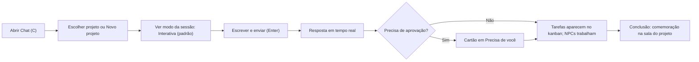

# Componentes do HUD, fluxos, microcopy e acessibilidade

> Autora: Bianca. Data: 2026-11-12. Base: PEDIDO §2–§7, REQUISITOS (CA-14, 19, 22, 23, 33, 37–42, 48–57, 60–64, 78–80). Tokens: `tokens.css`. Cores e contrastes: `GUIA-VISUAL.md`.
> Visual pronto para conferir: `mockups/index.html`. Este documento não define stack nem formato técnico; só comportamento, estados e textos.

---

## 1. Arquitetura da informação (mapa de telas)

O produto é **uma tela só** (o escritório) com camadas: HUD por cima do canvas, gavetas, painel inferior e diálogos. Não há navegação por páginas.

```mermaid
flowchart TD
    APP["Escritório (tela única)"] --> MAPA["Mapa em pixel art (canvas)"]
    APP --> TOP["Barra superior"]
    APP --> LEFT["Gaveta esquerda"]
    APP --> RIGHT["Gaveta direita"]
    APP --> BOTTOM["Painel inferior (recolhível)"]
    APP --> NAV["Navegação: minimapa, zoom, seguir NPC"]
    APP --> DLG["Diálogos e menus"]

    TOP --> T1["Nome do estúdio, relógio"]
    TOP --> T2["Medidores 5h e 7d"]
    TOP --> T3["Agentes X/16, Projetos ativos"]
    TOP --> T4["Som, Idioma, Modo TV, Configurações"]

    LEFT --> L1["Aba Projetos (cartões, +N aguardando)"]
    LEFT --> L2["Aba Equipe (lista de 16 + Freelancers)"]

    RIGHT --> R1["Chat com o Diretor"]
    RIGHT --> R2["Precisa de você (contador)"]
    RIGHT --> R3["Atividade (feed)"]
    RIGHT --> R4["Terminal"]
    RIGHT --> R5["Tokens"]

    BOTTOM --> B1["Quadro kanban (5 colunas)"]
    BOTTOM --> B2["Checklist: entregáveis e DoD"]
    BOTTOM --> B3["Linha do tempo do projeto"]

    MAPA --> M1["Cartão hover do NPC"]
    MAPA --> M2["Painel do NPC (clique)"]

    DLG --> D1["Novo projeto"]
    DLG --> D2["Histórico e retomar sessão"]
    DLG --> D3["Confirmar modo Automático / IA nas falas"]
    DLG --> D4["Configurações, Créditos, Atalhos"]
```



Prioridade de atenção (de cima para baixo, usada no celular e no Modo TV): 1) aprovações pendentes, 2) limite 5h/7d, 3) projetos e tarefas, 4) escritório.

## 2. Jornadas principais

### 2.1 Aprovar uma permissão
```mermaid
sequenceDiagram
    participant C as Claude Code
    participant P as Painel
    participant U as Carlos
    C->>P: PermissionRequest (ferramenta, projeto, agente)
    P->>U: Som "plim" + notificação + título "(1)" + NPC com "!" na porta da Diretoria
    U->>P: Abre aba "Precisa de você" (atalho A)
    P->>U: Cartão: quem pede, o quê, onde, tempo restante
    alt Aprovar
        U->>P: Aprovar
        P->>C: allow
        P->>U: Cartão "Aprovado" some em 4 s; "!" some
    else Negar
        U->>P: Negar
        P->>C: deny
    else Ver detalhes
        U->>P: Expande entrada completa (segredos mascarados)
    else Sem resposta no prazo
        P->>C: sem decisão (fluxo normal do Claude)
        P->>U: Cartão vira "Expirado — decida no terminal"
    end
```

### 2.2 Fazer um pedido ao Diretor


### 2.3 Acompanhar tarefa e seguir o NPC
Projetos (gaveta) → clicar no cartão (câmera vai à sala; painel inferior abre o kanban) → clicar numa tarefa "Em andamento" → câmera segue o NPC e a tarefa fica destacada → Esc ou "Parar de seguir".

### 2.4 Limite chegando ao fim
Barra passa de 60 % (amarela) → aos 80 %: banner de atenção + som (uma vez) → aos 85 %: barra vermelha → aos 95 %: banner crítico + barra com borda dupla/pisca (sem pisca em reduced-motion) → reset: banners rearmados (CA-60).

### 2.5 Novo agente contratado
Skill de RH atualiza `escritorio.json` → o painel mostra aviso discreto "Novo na equipe: {nome}" → NPC entra pela porta da Recepção, cena de boas-vindas, vai à vaga do departamento (ou mesa provisória, com aviso).

---

## 3. Layout geral (desktop ≥ 1280 px)

Referência: janela 1920×1080.

```
+--------------------------------------------------------------------------------+
| BARRA SUPERIOR (56 px)  Estúdio · 14:32 · [5h ▮▮▮▯] [7d ▮▮▯▯] · 3/16 · 2 proj · ♪ |
+------------+------------------------------------------------+------------------+
| GAVETA ESQ |                                                | GAVETA DIR  +rail|
| 320 px     |   MAPA (canvas, zoom 2×/3×/4×)                 | 380 px      48px |
| Projetos   |                                                | Chat/Precisa/    |
| Equipe     |             [minimapa 160×130 no canto]        | Atividade/Term/  |
|            |                                                | Tokens           |
+------------+------------------------------------------------+------------------+
| PAINEL INFERIOR (280 px; recolhido 40 px): Kanban | Checklist | Linha do tempo   |
+--------------------------------------------------------------------------------+
```

- O mapa ocupa todo o espaço restante; gavetas e painel inferior **sobrepõem** o mapa (não o redimensionam) para evitar recálculo de câmera; a câmera compensa o recorte ao centralizar (centraliza no espaço visível).
- Gavetas recolhíveis (botão e atalho); estado persistido. Largura fixa; em 1280–1535 px a gaveta esquerda começa recolhida.
- Breakpoints: ≥ 1280 desktop · 768–1279 tablet (uma gaveta aberta por vez, sobreposta) · < 768 celular (ver §6).
- Atalhos (só com foco fora de campos de texto, CA-23): **C** chat · **T** tarefas (abre/fecha painel inferior) · **A** aprovações · **M** minimapa expandido/mapa · **Esc** fecha o que estiver aberto · **?** lista de atalhos · **V** modo TV (sugestão).
- Ordem de tabulação: barra superior → gaveta esquerda → mapa (um único ponto de foco, com setas = mover câmera) → gaveta direita → painel inferior.

---

## 4. Especificação dos componentes

Estados padrão de qualquer controle: **normal / hover / foco / ativo / selecionado / desabilitado / erro** como em `GUIA-VISUAL.md` §8. Abaixo só o que é específico. "Foco" é sempre o anel duplo `--focus-ring`.

### 4.1 Barra superior
| Parte | Conteúdo | Observações |
|---|---|---|
| Nome do estúdio | Silkscreen 16 px, "Estúdio Carlos" (placeholder; vem da configuração) + brasão simples (xícara pixel) | clique abre Configurações → Nome |
| Relógio | `14:32` Pixelify 20 px, horário de Brasília; ao passar o mouse: data completa e fuso | `<time>`; atualiza a cada minuto |
| Medidores 5h e 7d | ver §4.2 | à direita do relógio |
| Agentes | ícone ⚙ + `3/16` e rótulo "trabalhando" (≥ 1280 px) | `aria-label="3 de 16 agentes trabalhando"` |
| Projetos ativos | ícone pasta + `2` | clique abre a gaveta Projetos |
| Som | botão de alternar (ligado/mudo); menu ao lado: música, efeitos, volume | `aria-pressed`; padrão **mudo** (CA-77) |
| Idioma | `PT` / `EN` | `lang` do documento muda junto |
| Modo TV | ícone tela cheia | ver §4.17 |
| Configurações | engrenagem | menu: idioma, reduzir movimento, modo da sessão, IA nas falas, decorações sazonais, créditos |

Estados: `desconectado` → faixa amarela logo abaixo da barra: "Sem conexão com o servidor. Tentando de novo…" (§5).

### 4.2 Medidor de limite (5h / 7d)
Anatomia (≈ 224×40 px por medidor): rótulo (`5h` / `7d`, Silkscreen 16) · barra de 16 px de altura com **20 segmentos** (estilo vida de jogo; cada segmento = 5 %), contorno 2 px `border-strong`, trilho `bg-track` · valor `72%` (Pixelify 16 bold, **fora** da barra, texto `text-1`) · contagem regressiva `reinicia em 2h 14min` (14 px, `text-2`) · selo de dado velho `atualizado há 7 min` (14 px, amarelo, só se > 2 min sem leitura, CA-61).

| Estado | Visual | Texto/ícone extra |
|---|---|---|
| Verde (0–60 %) | segmentos `#5FCB6E` | — |
| Amarelo (>60–85 %) | `#F2C94C` | ícone ▲ a partir de 80 % |
| Vermelho (>85 %) | `#F2685A` | ícone "!" |
| Crítico (>95 %) | vermelho alternando `#FFD84D` a 1 Hz + borda dupla | ícone "!!"; **reduced-motion**: sem alternar, borda dupla fixa |
| Dado velho | barra mantém o último valor com listras diagonais claras | selo "atualizado há X min" (CA-61) |
| Sem dados | trilho vazio | "sem dados" / "no data" + dica (CA-61) |
| Reiniciando | último valor esmaecido | "reiniciando…" (CA-57) |
| Valor suspeito (<0 ou >100) | limitado a 0–100 | ícone "?" + tooltip "valor suspeito" (CA-56) |
| Foco/hover | tooltip detalhado (valor, janela, reset em data/hora, última leitura) | tooltip persistente, fecha com Esc (WCAG 1.4.13) |

Acessibilidade: contêiner `role="meter"` (`aria-valuenow`, `aria-valuemin=0`, `aria-valuemax=100`, `aria-valuetext="Limite de 5 horas: 72 por cento, atenção. Reinicia em 2 horas e 14 minutos"`). Mudanças **não** são anunciadas continuamente; só cruzamento de limiar (80 %/95 %) via região `role="alert"` uma vez (§4.20).
Se houver `spend_limit` ou janela por modelo (CA-62): um 3º medidor no menu do medidor (não na barra) com as mesmas regras.

### 4.3 Gaveta esquerda: abas "Projetos" e "Equipe"
Cabeçalho: abas (`role="tablist"`), botão recolher. Largura 320 px.

**Aba Projetos** — lista de **cartões de projeto**:

| Elemento | Conteúdo |
|---|---|
| Linha 1 | nome da pasta (Pixelify 16 bold, 1 linha, reticências) · selo de tamanho **P / M / G** (Silkscreen 16, caixa 24×24, contorno) |
| Linha 2 | fase atual (ex.: "Construção") com ícone da fase · estado "ativo" (ponto verde + texto) ou "parado há 12 min" |
| Linha 3 | barra de progresso (12 px) + `64%` (ou `—` se sem plano, CA-49/50) |
| Linha 4 | pilha de até 4 rostos de NPCs trabalhando (16×16, contorno na cor do departamento) + "+2" · "há 3 min" (última atividade) |
| Sala | selo "Sala 2" quando tem sala; "Sem sala (fila +1)" quando aguarda vaga |

Estados do cartão: normal · hover (fundo mais claro) · foco · **selecionado** (borda esquerda 4 px `teal-300` + `aria-selected`) · ativo-trabalhando (ponto verde pulsante; estático em reduced-motion) · sem plano ("sem plano") · plano ilegível (borda `#F2685A`, "plano ilegível — linha 12") · fora de "7 - DEV" (rótulo "Fora de 7 - DEV"). Clique: seleciona, **centraliza a câmera na sala do projeto**, abre o painel inferior no kanban dele.
Rodapé da aba: seção "Aguardando sala (+N)" (CA-43). Estado vazio: "Nenhum projeto ativo. Peça algo ao Diretor." com botão "Abrir chat".

**Aba Equipe** (necessária para teclado e leitor de tela, pois o canvas não é navegável): lista de 16 + Freelancers: rosto 24 px, apelido, cargo, ícone de status + texto ("Trabalhando em Sites", "Parado há 32 min", "Aguardando aprovação"). Enter abre o painel do NPC; botão "Seguir" em cada linha; foco na linha mostra o cartão hover no mapa e destaca o NPC. Filtros: Todos / Trabalhando / Precisam de você.

### 4.4 Gaveta direita e trilho de abas
Largura 380 px + **trilho vertical de 48 px** na borda direita com 5 botões (ícone 20 px + contador): Chat (C) · Precisa de você (A, contador vermelho) · Atividade · Terminal · Tokens. Rótulo textual visível no cabeçalho da aba ativa e como tooltip/`aria-label`. `role="tablist"` vertical (`aria-orientation="vertical"`), setas ↑↓, Home/End. Fechar com Esc ou clicando no botão ativo.

### 4.5 Chat com o Diretor
Estrutura (de cima para baixo):
1. **Seletor de projeto** (combobox): lista das subpastas de "7 - DEV" (CA-27) + item final "Novo projeto…". Mostra "Projeto: Sites". Erro se pasta sumiu.
2. **Faixa do modo** (sempre visível, CA-34): selo "Sessão interativa" (verde-água) ou "Automático" (terracota, com ícone "!") + link "Trocar modo".
3. **Histórico** (botão "Conversas anteriores"): abre diálogo com sessões (data, primeiro pedido resumido, nº de mensagens; botão "Retomar") (CA-36).
4. **Lista de mensagens** (`role="log"`, `aria-live="polite"`, `aria-relevant="additions"`): bolhas do Carlos (direita, `bg-700`) e do Diretor (esquerda, com rosto 24 px e crachá dourado); markdown básico, código em mono com botão "Copiar"; texto sempre escapado (CA-47). Indicador "Diretor escrevendo…" (3 pontos; estático em reduced-motion).
5. **Compositor**: `textarea` (auto-altura 1–6 linhas), botão **Enviar** (teal), dica "Enter envia · Shift+Enter quebra linha". Contador de fila: "1 mensagem na fila" (CA-32).

Estados: sem projeto escolhido (compositor desabilitado + dica) · enviando · Diretor respondendo · sessão encerrada ("Sessão encerrada. Retomar?") · erro de sessão (`#F2685A`, botão "Tentar de novo") · desconectado · limite de sessões (CA-45: "Máximo de 4 sessões abertas") · aguardando aprovação (cartão em linha: "Há 1 aprovação pendente" com link para a aba A).
**Diálogo "Novo projeto"**: campo "Nome da pasta" (placeholder `meu-site`), regras no texto de ajuda; erros específicos por regra (vazio, > 100, caracteres inválidos, nome reservado, termina em ponto/espaço, já existe) (CA-28); botões "Criar" / "Cancelar".
**Diálogo "Ativar modo Automático"**: texto de custo (§7), checkbox obrigatório "Entendi", botões "Ativar para esta conversa" / "Cancelar"; foco inicial em "Cancelar".

### 4.6 Precisa de você (caixa de aprovações)
Cabeçalho: título + contador vermelho (`#F2685A`, texto `ink`, mín. 24×24, número ou "9+"). Lista de **cartões de aprovação**:

| Elemento | Conteúdo |
|---|---|
| Cabeçalho | rosto do NPC (32 px) · "Lívia pede permissão" · projeto "Sites" · tempo "há 8 s" |
| Corpo | ferramenta (`Bash`) em selo mono · resumo em 1–2 linhas ("npm install zod") |
| Prazo | "Decida em 0:42" + barra fina que esvazia (60 s padrão, CA-38); texto atualizado a cada 15 s para leitores |
| Ações | **Aprovar** (teal, ink) · **Negar** (contorno `danger-text`) · **Ver detalhes** (link/botão disclosure) |
| Detalhes | entrada completa da ferramenta em bloco mono; segredos mascarados `••••••••` (CA-37) |

Variante **aprovação de plano** (CA-41): corpo mostra o plano completo (rolagem) + campo opcional "Comentário" + mesmos botões; se não interceptável: cartão informativo "Plano aguardando aprovação no terminal" (sem botões, com ícone "!").

| Estado | Visual / texto |
|---|---|
| Pendente | borda 2 px `#F2685A`; foco inicial no cartão mais antigo ao abrir via atalho A |
| Hover/foco | fundo mais claro / anel duplo |
| Enviando | botões desabilitados, "Enviando…" |
| Aprovado / Negado | cartão fica 4 s com ícone e texto, depois some do contador |
| Expirado | borda cinza, "Expirado — decida no terminal"; não conta no contador; botões somem (CA-38) |
| Já respondido | "Já respondido em outra aba" (CA-40) |
| Erro ao enviar | borda vermelha + "Não foi possível enviar. Tente de novo." + botão "Tentar de novo" |
| Vazio | rosto do Diretor sorrindo: "Nada esperando por você." |

Comportamento: ao chegar um cartão: som "plim" (se som ligado), notificação do navegador (se permitida), título da aba `(n) Escritório da Equipe`, NPC com "!" na fila da Diretoria. Se a notificação foi negada: botão "Ativar notificações" na aba (CA-42).
Teclado: ↑/↓ percorre cartões; dentro do cartão Tab percorre os 3 botões; **nenhum atalho de letra única executa Aprovar/Negar** (evita acerto acidental; só clique/Enter no botão focado).
Leitor de tela: região `aria-live="assertive"` dedicada que diz uma frase curta quando um cartão novo chega ("Nova aprovação: Lívia, ferramenta Bash, projeto Sites") e **não** repete a contagem regressiva; o contador no trilho tem `aria-label="2 aprovações pendentes"`.

### 4.7 Atividade (feed)
Lista cronológica (mais novo no topo, mantém ≥ 200, CA-80). Cada linha: rosto 24 px com contorno na cor do departamento · texto em 1–2 linhas ("**Teresa** terminou *Testes de login* em Sites") · hora relativa ("há 2 min", `title` com a hora exata). Filtros em chips: Tudo · Aprovações · Tarefas · Alertas. Botão "Pausar atualizações" (útil para ler; WCAG 2.2.2). Linha nova ganha destaque 2 s (fixo com marcador "novo" em reduced-motion). Estados: vazio ("Ainda sem atividade hoje."), carregando (esqueleto 6 linhas), erro ("Não consegui carregar a atividade.").
A lista **não** é região viva (ruído); uma região `role="status"` anuncia só eventos importantes (conclusão de projeto, alerta).

### 4.8 Painel inferior (kanban)
Barra do painel (40 px): título do projeto ("Sites · Construção · G") · abas **Quadro / Checklist / Linha do tempo** · botão recolher (T). Altura 280 px, redimensionável por teclado (setas na alça) e mouse.
**Kanban**: 5 colunas fixas — **A fazer · Em andamento · Em revisão · Concluída · Bloqueada** — cada uma com contador no cabeçalho e rolagem própria. Cada **cartão de tarefa**: rosto do NPC (24 px) · título (2 linhas, reticências) · id curto (`T-07`) · responsável por extenso no `title` · selo "status não reconhecido" quando aplicável (CA-51). Bloqueada: borda esquerda `#F2685A` + ícone + motivo, se houver.

| Estado do cartão | Visual |
|---|---|
| Normal | `bg-700`, contorno `border-strong` |
| Hover | fundo mais claro |
| Foco | anel duplo |
| Selecionado/seguindo | borda esquerda 4 px `teal-300` + selo "Seguindo" + `aria-pressed="true"` |
| Sem NPC trabalhando | clique mostra toast "Ninguém trabalhando nesta tarefa agora" (CA-54) |
| Desabilitado | não existe (kanban somente leitura, F-11) |
| Vazio (coluna) | "Nada aqui." (texto `text-3`) |
| Sem plano | quadro vazio com "Este projeto ainda não tem PLANO.md." |
| Plano ilegível | "Plano ilegível — linha {n}" com link "Ver detalhes" |

Teclado: Tab entra no quadro; ←/→ muda de coluna, ↑/↓ de cartão, **Enter** segue o NPC, **Esc** para de seguir. Estrutura: cada coluna é `section` com `aria-labelledby` ("Em andamento, 2 tarefas"), cartões são `button`.
**Checklist** (aba): duas listas "Entregáveis (4/9)" e "Definition of Done (7/10)", itens com ícone ☑/☐ **e** texto ("feito"/"pendente" para leitores), somente leitura; barra mínima de resumo.
**Linha do tempo** (aba): `ol` horizontal com 6 etapas — Planejado → Aprovado → Construção → Qualidade → Docs → PR pronto; etapa concluída (círculo cheio + ✓), atual (anel dourado 4 px, `aria-current="step"`, texto em negrito), futura (círculo vazio, `text-3`). Rótulos sempre visíveis (não só cor). No celular vira lista vertical.

### 4.9 Cartão hover do NPC
Aparece em ≤ 150 ms ao passar o mouse sobre o NPC (ou ao focar a linha na aba Equipe), ancorado acima da cabeça (se faltar espaço, abaixo). Tamanho ~ 260×112 px, `z-popover`, sombra px2.
Conteúdo: rosto 32 px · **nome completo** (Pixelify 16 bold) · cargo (14, `text-2`) · selo do departamento (crachá `light`) · linha de status com ícone: "Trabalhando em *Testes de login* no projeto *Sites* · há 12 min" / "Parado · há 32 min" / "Aguardando aprovação · há 20 s". Freelancer: selo "VISITANTE" + "agent_type: general-purpose".
Regras (WCAG 1.4.13): some ao sair; **persistente** enquanto o mouse estiver sobre o cartão; fecha com Esc; não rouba foco. Sem mouse (celular): toque no NPC abre direto o painel (§4.10).

### 4.10 Painel do NPC (clique)
Painel flutuante 360×auto à esquerda ou direita (onde houver espaço), `role="dialog"` não modal; fecha com Esc, clique fora ou botão ×.
Seções: **Cabeçalho** (retrato 48 px, nome, cargo, selo do depto, status) · **Tarefas atuais** (lista com link que seleciona o cartão no kanban) · **Histórico recente** (≥ 10 itens com hora, CA-19) · **Tokens hoje** (número + barra mínima; "indisponível" até a fase 3) · botões **Seguir** / **Parar de seguir**, **Ir para a mesa** (centraliza a câmera na mesa).
Estados: carregando (esqueleto) · sem histórico ("Nada registrado hoje.") · erro ("Não consegui carregar o histórico.").

### 4.11 Aba Terminal
Quadro com o terminal cru (mono 14 px, altura de linha 18 px, fundo `bg-track`), cabeçalho: nome da sessão e projeto, **estado** (selo: "Conectado", "Conectando…", "Encerrado") e chave **"Permitir digitação"** (desligada por padrão, CA-33; ao ligar pede confirmação). Modo somente leitura: faixa "Somente leitura" + `aria-readonly`. Redimensiona com a gaveta. Estados: sem sessão ("Nenhuma sessão aberta. Abra o Chat e envie um pedido."), conectando, desconectado ("Conexão com o terminal perdida" + "Reconectar"), erro. Acessibilidade: o terminal é uma região com rótulo e texto selecionável; aviso "Conteúdo bruto do terminal; use o Chat para uma leitura formatada".

### 4.12 Aba Tokens
Controles: segmentos **Por agente · Por projeto · Por dia** e período **Hoje · 7 dias · 30 dias** (retenção dos logs é 30 dias, PESQUISA §C).
Gráfico de **barras horizontais** simples: cada barra com rótulo (rosto + nome ou projeto ou data), valor formatado ("1,2 mi", "345 mil"), barras empilhadas **entrada / saída / cache** com padrões distintos (listra, pontilhado, liso) além da cor, legenda fixa. Cor da barra por agente = `light` do departamento. Ordenado do maior para o menor.
Alternativa acessível: botão "Ver como tabela" (tabela `<table>` com cabeçalhos) — é o conteúdo lido por leitores de tela; o gráfico tem `role="img"` com `aria-label` resumido ("Tokens por agente hoje: Lívia 1,2 mi, Bruno 800 mil…").
Rodapé: "N linhas ignoradas" (CA-63) e "Atualizado há X min". Estados: vazio ("Sem consumo registrado neste período."), carregando, erro, parcial ("Alguns registros não puderam ser lidos").

### 4.13 Minimapa
Canvas de **160×130 px** (≈ 2,5 px por tile) no canto inferior esquerdo do mapa (acima do painel inferior), mostra salas na cor `base`, pontos 3×3 px por NPC (cor do departamento, com forma de losango para quem precisa de você) e um retângulo da área visível. Clique ou arraste centraliza; **teclado**: foco no minimapa, setas movem 4 tiles, Enter centraliza, `+/-` muda o zoom. **M** alterna entre minimapa pequeno e expandido (320×260). Botão recolher. Rótulo `aria-label="Minimapa do escritório"`; é redundante com a aba Equipe (não é a única via de acesso).

### 4.14 Controles de câmera e "Seguir NPC"
Grupo no canto inferior direito do mapa: **− / 2× / +** (só valores inteiros 2×, 3×, 4×, o scroll do mouse também troca de nível, com acúmulo para evitar saltos), **Centralizar**, **Seguir NPC** (botão que abre um seletor com a lista de NPCs; ou segue o NPC selecionado). Ao seguir: selo no topo do mapa "Seguindo: Lívia ✕" (botão para parar); mover o mapa com o mouse também para o seguimento. Estados: normal, ativo (seguindo, `aria-pressed`), desabilitado (nenhum NPC ativo). Em reduced-motion a câmera "pula" para o destino em vez de deslizar.

### 4.15 Alertas de limite (80 % e 95 %)
Banner fixo logo abaixo da barra superior, largura total do mapa:
- **80 %** (`bg-700`, borda esquerda 4 px `#F2C94C`, ícone ▲): "Atenção: você usou 80 % do limite de 5 horas. Reinicia em 1h 12min." Botões "Ver uso" / "Dispensar".
- **95 %** (fundo `#F2685A`, texto `ink` 5,66:1, ícone "!!"): "Crítico: 95 % do limite de 5 horas. Reinicia em 1h 12min. Considere pausar pedidos."
- Dispensar esconde até o próximo limiar/ciclo; reaparece em 5 min se o valor continuar > 95 % (decisão aberta, ver §9). Som uma vez por limiar (respeita mudo). `role="alert"`, uma vez.
- Em reduced-motion: sem pisca nem deslize.

### 4.16 Toasts
Canto inferior central, empilha até 3, 4 s (6 s para erro, com botão fechar); `role="status"` (ou `alert` para erro). Exemplos: "Projeto *Sites* concluído!", "Novo na equipe: Marcos", "Notificações ativadas". Passar o mouse/foco pausa o tempo.

### 4.17 Modo TV
Botão na barra superior (ou **V**): usa tela cheia. Esconde gavetas, painel inferior e minimapa; mantém o mapa e uma **faixa de resumo** no topo (altura 88 px, fonte ×1,5): relógio · medidores 5h e 7d (barra de 32 px, valor 32 px, reset 20 px) · "Precisa de você: 2" (badge grande vermelho, pisca só se não reduced-motion) · "Agentes 3/16". Sem token, URL ou dados sensíveis (CA-78). Cursor some após 5 s parado; **Esc** (ou clique no botão "Sair do modo TV" que aparece ao mexer o mouse) sai. Mínimo de texto 20 px.

### 4.18 Estados globais
| Situação | Onde | Visual | Texto |
|---|---|---|---|
| **Carregando** (primeira abertura) | tela cheia sobre o mapa | tela creme escuro com xícara pixel animada (estática em reduced-motion) e barra | "Abrindo o escritório…" |
| **Desconectado** | faixa abaixo da barra superior | amarela, ícone ▲, tenta reconectar com recuo | "Sem conexão com o servidor. Tentando de novo em {n} s…" + botão "Tentar agora" |
| **Desconectado há mais de 2 min** | idem | vira vermelha | "Servidor indisponível. Confira se ele está ligado." |
| **Token inválido/ausente** | tela de bloqueio | cartão central | "Acesso negado. Abra o escritório pelo atalho ou pelo endereço com token." (sem expor o token) |
| **Aba oculta** | — | animação pausa; ao voltar, "retomando" 300 ms | — |
| **`escritorio.json` inválido** (CA-13) | banner | amarelo | "Arquivo escritorio.json com problema no campo {campo}. Usando a última versão válida." |
| **Dados do limite indisponíveis** | medidor | "sem dados" | "Sem dados de limite ainda. Faça uma pergunta no Claude Code para atualizar." |
| **Sessões do Desktop não detectadas** (CA-18) | banner informativo | azul-água | "Sessões do Claude Desktop não detectadas. Só vejo sessões abertas pelo painel ou pelo terminal." |

### 4.19 Avatar do NPC (componente compartilhado)
Qualquer lugar onde aparece "rosto do NPC" (feed, kanban, cartão de projeto, aprovação) usa o mesmo **componente Avatar**: retrato 16×16 ampliado em múltiplos inteiros (24/32/48 px com `image-rendering: pixelated`, nunca fracionado), moldura 2 px na cor `light` do departamento, `alt` = nome (ou vazio quando o nome está escrito ao lado, `aria-hidden`).

### 4.20 Região de anúncios para leitores de tela
Duas regiões globais: `role="status"` (polite) e `role="alert"` (assertive). Anunciar: nova aprovação, limiar de limite cruzado (uma vez), projeto concluído, erro de envio. **Não** anunciar: contagens regressivas, atualizações de barra, feed rotineiro, movimento de NPCs.

---

## 5. Estados vazios, de erro, de carregamento e desconectado (resumo por área)

| Área | Vazio | Carregando | Erro | Desconectado |
|---|---|---|---|---|
| Projetos | "Nenhum projeto ativo. Peça algo ao Diretor." | esqueleto de 3 cartões | "Não consegui listar os projetos." + Tentar de novo | mostra o último estado, esmaecido, com selo "desatualizado" |
| Equipe | (nunca vazio) | esqueleto | "Não consegui ler escritorio.json." | último estado |
| Chat | "Escolha um projeto e conte o que precisa." | "Conectando à sessão…" | "A sessão falhou. Tentar de novo?" | "Chat indisponível sem conexão." (compositor desabilitado, texto preservado) |
| Precisa de você | "Nada esperando por você." | "Verificando…" | "Não foi possível enviar." | "Aprovações pausadas: sem conexão. O Claude vai pedir no terminal." |
| Atividade | "Ainda sem atividade hoje." | esqueleto | "Não consegui carregar a atividade." | último estado |
| Kanban | "Este projeto ainda não tem PLANO.md." | esqueleto | "Plano ilegível — linha {n}." | último estado + selo |
| Tokens | "Sem consumo registrado neste período." | esqueleto | "Não consegui ler os registros." | último estado |
| Terminal | "Nenhuma sessão aberta." | "Conectando…" | "Falha no terminal." | "Conexão perdida." + Reconectar |

---

## 6. Celular (< 768 px; acesso só local)

Estrutura vertical, nesta ordem:
1. **Barra compacta (48 px)**: nome (truncado), medidores em forma mínima (duas barras de 8 px + percentuais), contador de aprovações (botão 44×44).
2. **Mapa reduzido** (altura 36 vh, mín. 220 px, zoom 2× fixo com arrastar para mover; sem minimapa; controles de zoom 44 px). Toque no NPC abre o painel do NPC como folha inferior.
3. **Abas em lista** (resto da tela, rolagem): barra de 5 botões (≥ 44×44, ícone + rótulo curto): **Precisa de você · Projetos · Chat · Atividade · Mais** (Mais: Equipe, Tokens, Terminal, Configurações). O conteúdo da aba ativa aparece abaixo, em **lista de uma coluna**; cartões ocupam a largura inteira. Aba ativa **Precisa de você** por padrão quando há pendências.
4. **Kanban**: vira lista agrupada por coluna (acordeões "Em andamento (2)"), sem rolagem horizontal.
5. Compositor do chat fixo na base com `env(safe-area-inset-bottom)`.
Regras: sem rolagem horizontal; reflow a 320 px (WCAG 1.4.10); alvos ≥ 44 px; textos mín. 14 px; aprovação com botões grandes lado a lado (Aprovar / Negar ≥ 48 px de altura) e confirmação por toque único, sem arrastar.

---

## 7. Microcopy final (pt-BR e en)

Convenções: pt-BR padrão; `{x}` são variáveis; tom definido em `GUIA-VISUAL.md` §1; sem emoji (ícones são sprites); sem ponto final em rótulos de botão; sempre "você", nunca culpar.

### 7.1 Geral e barra superior
| Chave | pt-BR | en |
|---|---|---|
| app.name | Escritório da Equipe | Team Office |
| studio.placeholder | Estúdio Carlos | Carlos Studio |
| top.clock.label | Horário de Brasília | Brasília time |
| top.agents | Agentes {n}/{total} | Agents {n}/{total} |
| top.agents.aria | {n} de {total} agentes trabalhando | {n} of {total} agents working |
| top.projects | Projetos ativos: {n} | Active projects: {n} |
| top.sound.on | Som ligado | Sound on |
| top.sound.off | Som desligado | Sound off |
| top.tv | Modo TV | TV mode |
| top.tv.exit | Sair do modo TV | Exit TV mode |
| top.settings | Configurações | Settings |
| top.lang | Idioma | Language |

### 7.2 Medidor e alertas
| Chave | pt-BR | en |
|---|---|---|
| meter.5h | Limite de 5 horas | 5-hour limit |
| meter.7d | Limite de 7 dias | 7-day limit |
| meter.reset | reinicia em {t} | resets in {t} |
| meter.resetting | reiniciando… | resetting… |
| meter.stale | atualizado há {t} | updated {t} ago |
| meter.nodata | sem dados | no data |
| meter.nodata.hint | Sem dados de limite ainda. Faça uma pergunta no Claude Code para atualizar. | No limit data yet. Ask something in Claude Code to refresh it. |
| meter.suspect | valor suspeito | suspicious value |
| meter.aria | {janela}: {p} por cento, {estado}. Reinicia em {t}. | {window}: {p} percent, {state}. Resets in {t}. |
| meter.state.ok | tranquilo | fine |
| meter.state.warn | atenção | caution |
| meter.state.high | alto | high |
| meter.state.crit | crítico | critical |
| alert.80 | Atenção: você usou {p}% do {janela}. Reinicia em {t}. | Heads up: you've used {p}% of the {window}. Resets in {t}. |
| alert.95 | Crítico: {p}% do {janela}. Reinicia em {t}. Considere pausar novos pedidos. | Critical: {p}% of the {window}. Resets in {t}. Consider pausing new requests. |
| alert.dismiss | Dispensar | Dismiss |
| alert.view | Ver uso | View usage |
| time.min | {n} min | {n} min |
| time.hm | {h}h {m}min | {h}h {m}m |
| time.dh | {d}d {h}h | {d}d {h}h |
| time.ago.min | há {n} min | {n} min ago |
| time.ago.h | há {h} h {m} min | {h} h {m} min ago |
| time.ago.now | agora há pouco | just now |

### 7.3 Projetos e equipe
| Chave | pt-BR | en |
|---|---|---|
| proj.title | Projetos | Projects |
| proj.size | Tamanho {s} | Size {s} |
| proj.phase | Fase: {f} | Phase: {p} |
| proj.active | ativo | active |
| proj.idle | parado há {t} | idle for {t} |
| proj.noplan | sem plano | no plan |
| proj.badplan | plano ilegível — linha {n} | unreadable plan — line {n} |
| proj.outside | Fora de 7 - DEV | Outside 7 - DEV |
| proj.waiting | Aguardando sala (+{n}) | Waiting for a room (+{n}) |
| proj.empty | Nenhum projeto ativo. Peça algo ao Diretor. | No active projects. Ask the Director for something. |
| proj.open.chat | Abrir chat | Open chat |
| team.title | Equipe | Team |
| team.status.working | Trabalhando em {tarefa} no projeto {pasta} | Working on {task} in project {folder} |
| team.status.idle | Parado há {t} | Idle for {t} |
| team.status.waiting | Aguardando aprovação | Waiting for approval |
| team.status.break | Em pausa | On a break |
| team.follow | Seguir | Follow |
| team.unfollow | Parar de seguir | Stop following |
| team.following | Seguindo: {nome} | Following: {name} |
| team.freelancer | Freelancer (visitante) | Freelancer (visitor) |
| team.visitor | VISITANTE | VISITOR |
| team.newhire | Novo na equipe: {nome} | New on the team: {name} |
| npc.history | Histórico recente | Recent history |
| npc.tasks | Tarefas atuais | Current tasks |
| npc.tokens | Tokens hoje | Tokens today |
| npc.tokens.na | indisponível por enquanto | not available yet |
| npc.goto.desk | Ir para a mesa | Go to desk |
| npc.empty | Nada registrado hoje. | Nothing recorded today. |

### 7.4 Chat
| Chave | pt-BR | en |
|---|---|---|
| chat.title | Chat com o Diretor | Chat with the Director |
| chat.project | Projeto | Project |
| chat.project.pick | Escolha um projeto | Choose a project |
| chat.project.new | Novo projeto… | New project… |
| chat.empty | Escolha um projeto e conte o que precisa. | Choose a project and tell me what you need. |
| chat.placeholder | Escreva seu pedido… | Write your request… |
| chat.hint | Enter envia · Shift+Enter quebra linha | Enter sends · Shift+Enter for a new line |
| chat.send | Enviar | Send |
| chat.queued | {n} mensagem na fila | {n} message queued |
| chat.queued.plural | {n} mensagens na fila | {n} messages queued |
| chat.typing | O Diretor está escrevendo… | The Director is writing… |
| chat.mode.interactive | Sessão interativa | Interactive session |
| chat.mode.auto | Automático | Automatic |
| chat.mode.change | Trocar modo | Change mode |
| chat.history | Conversas anteriores | Previous conversations |
| chat.resume | Retomar | Resume |
| chat.ended | Sessão encerrada. Retomar? | Session ended. Resume? |
| chat.error | A sessão falhou. Tentar de novo? | The session failed. Try again? |
| chat.max | Máximo de {n} sessões abertas. Encerre uma para abrir outra. | Maximum of {n} open sessions. End one to open another. |
| chat.offline | Chat indisponível sem conexão. | Chat unavailable while offline. |
| chat.copy | Copiar | Copy |
| chat.copied | Copiado | Copied |
| chat.pending | Há {n} aprovação pendente | {n} approval pending |
| newproj.title | Novo projeto | New project |
| newproj.label | Nome da pasta | Folder name |
| newproj.placeholder | meu-site | my-site |
| newproj.help | Até 100 caracteres. Sem \ / : * ? " < > \| nem espaço no fim. | Up to 100 characters. No \ / : * ? " < > \| and no trailing space. |
| newproj.create | Criar | Create |
| newproj.err.empty | Informe um nome. | Enter a name. |
| newproj.err.long | O nome passa de 100 caracteres. | The name is over 100 characters. |
| newproj.err.chars | O nome tem caracteres que o Windows não aceita. | The name has characters Windows doesn't allow. |
| newproj.err.reserved | Esse nome é reservado pelo Windows. Escolha outro. | That name is reserved by Windows. Pick another. |
| newproj.err.trailing | O nome não pode terminar com ponto ou espaço. | The name can't end with a dot or a space. |
| newproj.err.exists | Já existe uma pasta com esse nome. | A folder with that name already exists. |
| auto.title | Ativar o modo Automático? | Turn on Automatic mode? |
| auto.body | O modo Automático usa `claude -p` (sem terminal). Hoje, no seu plano, isso conta no mesmo limite de 5 horas e 7 dias. A Anthropic pode separar esse consumo no futuro. **[Texto final a confirmar após a pesquisa de cobrança, antes da fase 2.]** | Automatic mode uses `claude -p` (no terminal). Today, on your plan, this counts toward the same 5-hour and 7-day limits. Anthropic may separate this usage in the future. **[Final wording to be confirmed after the billing research, before phase 2.]** |
| auto.check | Entendi e quero ativar para esta conversa | I understand and want to turn it on for this conversation |
| auto.confirm | Ativar | Turn on |
| auto.cancel | Cancelar | Cancel |

### 7.5 Precisa de você
| Chave | pt-BR | en |
|---|---|---|
| need.title | Precisa de você | Needs you |
| need.count.aria | {n} aprovações pendentes | {n} pending approvals |
| need.card.title | {nome} pede permissão | {name} is asking for permission |
| need.tool | Ferramenta: {t} | Tool: {t} |
| need.deadline | Decida em {t} | Decide within {t} |
| need.approve | Aprovar | Approve |
| need.deny | Negar | Deny |
| need.details | Ver detalhes | View details |
| need.details.hide | Ocultar detalhes | Hide details |
| need.sending | Enviando… | Sending… |
| need.approved | Aprovado | Approved |
| need.denied | Negado | Denied |
| need.expired | Expirado — decida no terminal | Expired — decide in the terminal |
| need.already | Já respondido em outra aba | Already answered in another tab |
| need.error | Não foi possível enviar. Tente de novo. | Couldn't send. Try again. |
| need.retry | Tentar de novo | Try again |
| need.empty | Nada esperando por você. | Nothing waiting for you. |
| need.masked | Valor oculto | Hidden value |
| need.announce | Nova aprovação: {nome}, ferramenta {t}, projeto {p} | New approval: {name}, tool {t}, project {p} |
| need.plan.title | {nome} enviou um plano | {name} sent a plan |
| need.plan.comment | Comentário (opcional) | Comment (optional) |
| need.plan.terminal | Plano aguardando aprovação no terminal | Plan waiting for approval in the terminal |
| need.notif.enable | Ativar notificações | Turn on notifications |
| need.notif.denied | Notificações bloqueadas no navegador. O aviso sonoro e o contador continuam funcionando. | Notifications are blocked in the browser. The sound and the counter still work. |
| need.paused | Aprovações pausadas: sem conexão. O Claude vai pedir no terminal. | Approvals paused: no connection. Claude will ask in the terminal. |

### 7.6 Atividade, kanban, checklist, linha do tempo
| Chave | pt-BR | en |
|---|---|---|
| act.title | Atividade | Activity |
| act.filter.all | Tudo | All |
| act.filter.approvals | Aprovações | Approvals |
| act.filter.tasks | Tarefas | Tasks |
| act.filter.alerts | Alertas | Alerts |
| act.pause | Pausar atualizações | Pause updates |
| act.resume | Retomar atualizações | Resume updates |
| act.new | novo | new |
| act.empty | Ainda sem atividade hoje. | No activity yet today. |
| act.item.done | {nome} terminou {tarefa} em {p} | {name} finished {task} in {p} |
| act.item.start | {nome} começou {tarefa} em {p} | {name} started {task} in {p} |
| act.item.call | O Diretor chamou {nome} | The Director called {name} |
| kb.title | Tarefas | Tasks |
| kb.col.todo | A fazer | To do |
| kb.col.doing | Em andamento | In progress |
| kb.col.review | Em revisão | In review |
| kb.col.done | Concluída | Done |
| kb.col.blocked | Bloqueada | Blocked |
| kb.col.aria | {coluna}, {n} tarefas | {column}, {n} tasks |
| kb.empty.col | Nada aqui. | Nothing here. |
| kb.noplan | Este projeto ainda não tem PLANO.md. | This project doesn't have a PLANO.md yet. |
| kb.unknown | status não reconhecido | unrecognized status |
| kb.nobody | Ninguém trabalhando nesta tarefa agora. | Nobody is working on this task right now. |
| kb.following | Seguindo | Following |
| kb.tab.board | Quadro | Board |
| kb.tab.checklist | Checklist | Checklist |
| kb.tab.timeline | Linha do tempo | Timeline |
| cl.deliverables | Entregáveis ({a}/{b}) | Deliverables ({a}/{b}) |
| cl.dod | Definition of Done ({a}/{b}) | Definition of Done ({a}/{b}) |
| cl.done | feito | done |
| cl.pending | pendente | pending |
| tl.planned | Planejado | Planned |
| tl.approved | Aprovado | Approved |
| tl.build | Construção | Build |
| tl.quality | Qualidade | Quality |
| tl.docs | Docs | Docs |
| tl.pr | PR pronto | PR ready |
| tl.current | etapa atual | current step |
| proj.done | Projeto {p} concluído! | Project {p} complete! |

### 7.7 Terminal, tokens, navegação, TV
| Chave | pt-BR | en |
|---|---|---|
| term.title | Terminal | Terminal |
| term.readonly | Somente leitura | Read-only |
| term.allow | Permitir digitação | Allow typing |
| term.allow.confirm | Digitar aqui envia comandos direto para o Claude. Ativar mesmo assim? | Typing here sends input straight to Claude. Turn on anyway? |
| term.empty | Nenhuma sessão aberta. Abra o Chat e envie um pedido. | No open session. Open the Chat and send a request. |
| term.connecting | Conectando… | Connecting… |
| term.lost | Conexão com o terminal perdida | Terminal connection lost |
| term.reconnect | Reconectar | Reconnect |
| term.note | Conteúdo bruto do terminal. Use o Chat para uma leitura formatada. | Raw terminal output. Use the Chat for a formatted view. |
| tok.title | Tokens | Tokens |
| tok.by.agent | Por agente | By agent |
| tok.by.project | Por projeto | By project |
| tok.by.day | Por dia | By day |
| tok.period.today | Hoje | Today |
| tok.period.7d | 7 dias | 7 days |
| tok.period.30d | 30 dias | 30 days |
| tok.input | Entrada | Input |
| tok.output | Saída | Output |
| tok.cache | Cache | Cache |
| tok.table | Ver como tabela | View as table |
| tok.chart | Ver como gráfico | View as chart |
| tok.ignored | {n} linhas ignoradas | {n} lines ignored |
| tok.empty | Sem consumo registrado neste período. | No usage recorded in this period. |
| tok.partial | Alguns registros não puderam ser lidos. | Some records couldn't be read. |
| map.minimap | Minimapa do escritório | Office minimap |
| map.zoom.in | Aproximar | Zoom in |
| map.zoom.out | Afastar | Zoom out |
| map.center | Centralizar | Center |
| map.follow | Seguir NPC | Follow character |
| tv.summary.needs | Precisa de você: {n} | Needs you: {n} |

### 7.8 Estados globais, configurações, atalhos
| Chave | pt-BR | en |
|---|---|---|
| state.loading | Abrindo o escritório… | Opening the office… |
| state.offline | Sem conexão com o servidor. Tentando de novo em {n} s… | No connection to the server. Retrying in {n} s… |
| state.offline.now | Tentar agora | Try now |
| state.offline.long | Servidor indisponível. Confira se ele está ligado. | Server unavailable. Check that it's running. |
| state.token | Acesso negado. Abra o escritório pelo atalho ou pelo endereço com token. | Access denied. Open the office from the shortcut or the address with the token. |
| state.json | Arquivo escritorio.json com problema no campo {campo}. Usando a última versão válida. | escritorio.json has a problem in field {field}. Using the last valid version. |
| state.desktop | Sessões do Claude Desktop não detectadas. Só vejo sessões abertas pelo painel ou pelo terminal. | Claude Desktop sessions not detected. I can only see sessions opened from the panel or the terminal. |
| state.outdated | desatualizado | outdated |
| set.title | Configurações | Settings |
| set.reduce | Reduzir movimento | Reduce motion |
| set.season | Decorações sazonais | Seasonal decorations |
| set.ai | Falas geradas por IA (consome limite) | AI-generated chatter (uses your limit) |
| set.credits | Créditos | Credits |
| set.shortcuts | Atalhos de teclado | Keyboard shortcuts |
| short.c | C — Chat | C — Chat |
| short.t | T — Tarefas | T — Tasks |
| short.a | A — Aprovações | A — Approvals |
| short.m | M — Mapa | M — Map |
| short.esc | Esc — Fechar | Esc — Close |
| common.close | Fechar | Close |
| common.cancel | Cancelar | Cancel |
| common.retry | Tentar de novo | Try again |
| common.loading | Carregando… | Loading… |

### 7.9 Falas de NPC (exemplos de tom; a biblioteca completa é da fase 4)
pt-BR: "Alguém quer café?" · "Viu que a Teresa achou 2 bugs no Sites?" · "O Otávio tá migrando módulo de novo…" · "A Gabriela devolveu meu commit, acredita?" · "O Diretor aprovou o projeto novo!" · "Lívia, preciso de você!" · "Hora do fliperama." · "Ufa, só mais um teste."
en: "Anyone for coffee?" · "Did you hear Teresa found 2 bugs in Sites?" · "Otávio is migrating a module again…" · "Gabriela sent my commit back, can you believe it?" · "The Director approved the new project!" · "Lívia, I need you!" · "Arcade time." · "Phew, just one more test."
Regras: ≤ 60 caracteres, uma ideia, sem nomes de pessoas reais fora da equipe, nunca expor conteúdo de código ou de conversas (CA-67).

---

## 8. Checklist de acessibilidade para a Lívia (WCAG 2.2 AA)

Marque cada item ao implementar; a Teresa confere.

**Estrutura e linguagem**
- [ ] `lang="pt-BR"` ou `en` no `<html>`, atualizado ao trocar idioma; trechos em outro idioma com `lang` (3.1.1, 3.1.2).
- [ ] Uma landmark por área: `header` (barra), `nav`/`aside` (gavetas), `main` (mapa), `region` (painel inferior), com `aria-label`.
- [ ] "Pular para o conteúdo / para aprovações" como primeiro link (2.4.1).
- [ ] Ordem de foco lógica (§3); sem armadilha de foco; diálogos modais prendem o foco e devolvem ao gatilho ao fechar (2.4.3).

**Teclado**
- [ ] Todo controle da HUD alcançável por Tab e operável por Enter/Espaço; setas nos conjuntos (abas, kanban, minimapa) (2.1.1).
- [ ] Atalhos C, T, A, M, V, ? **desligados** quando o foco está em `input`, `textarea`, `select`, `contenteditable` ou terminal (CA-23; 2.1.4); Esc fecha o item mais interno.
- [ ] Nenhum atalho de letra única executa ação destrutiva ou decisão (Aprovar/Negar só pelo botão focado).
- [ ] O canvas é **um único ponto de foco**; setas movem a câmera, `+`/`-` zoom, Enter abre o NPC do centro (se houver); NPCs também são alcançáveis pela aba **Equipe**.
- [ ] Qualquer ação de arrastar (minimapa, redimensionar painel) tem alternativa por teclado/clique (2.5.7).

**Foco e alvo**
- [ ] Anel de foco duplo (`--focus-ring`) visível em todos os estados e fundos (2.4.7, 1.4.11); nunca `outline: none` sem substituto.
- [ ] Foco **não coberto** por barras fixas/gavetas (2.4.11): `scroll-padding` igual à altura da barra superior/inferior.
- [ ] Alvos ≥ 32×32 px no desktop e ≥ 44×44 px no celular (2.5.8 exige 24; adotamos mais).

**Cor, contraste e movimento**
- [ ] Contrastes conforme `GUIA-VISUAL.md` §4 (texto ≥ 4,5:1; UI/ícones/foco ≥ 3:1); a Teresa recalcula por script (1.4.3, 1.4.11).
- [ ] Nenhuma informação só por cor: medidor, status do NPC, estado de cartão e gráfico têm ícone/texto/padrão (1.4.1).
- [ ] Nada pisca mais de 3 vezes por segundo; medidor crítico a 1 Hz (2.3.1).
- [ ] `prefers-reduced-motion` e a opção "Reduzir movimento" desligam: pisca do medidor, deslizes, máquina de escrever, confete, chuva, mascotes correndo, pulo do "!" (CA-22).
- [ ] Animação contínua > 5 s tem controle de pausa (feed: "Pausar atualizações"; música: play/pause) (2.2.2).
- [ ] Texto redimensionável a 200 % e reflow a 320 px sem perda (1.4.4, 1.4.10); espaçamento de texto sem quebra (1.4.12).

**Leitor de tela**
- [ ] Medidor com `role="meter"` + `aria-valuetext` completo; **sem** anúncio a cada atualização (4.1.3).
- [ ] Região `role="alert"` (assertive) para nova aprovação, limiares 80 %/95 % e erros de envio; região `role="status"` (polite) para conclusões e toasts; **sem** repetir contagem regressiva.
- [ ] Contador "Precisa de você" com `aria-label` ("2 aprovações pendentes") e título da aba `(2) …`.
- [ ] Cartões de aprovação: rótulo programático com quem, ferramenta, projeto; botões com nome claro ("Aprovar pedido de Lívia, Bash"); "Ver detalhes" é `button` com `aria-expanded`.
- [ ] Kanban: colunas com `aria-labelledby` e contagem; cartões `button` com `aria-pressed` quando seguindo.
- [ ] Gráfico de tokens com alternativa em tabela; gráfico `role="img"` com resumo.
- [ ] Imagens de rosto com `alt` = nome (ou `alt=""` se o nome está ao lado); ícones decorativos `aria-hidden="true"`; ícones de status sempre com texto equivalente.
- [ ] Mapa (canvas) com `aria-label` descritivo e resumo textual dinâmico acessível (aba Equipe) — o canvas não é a única fonte de informação.

**Conteúdo e interação**
- [ ] Cartão hover: persistente, dispensável com Esc, não some ao mover o mouse até ele (1.4.13).
- [ ] Mensagens de erro identificam o campo e dizem como corrigir (3.3.1, 3.3.3); `aria-invalid` + `aria-describedby`.
- [ ] Não pedir o mesmo dado duas vezes (3.3.7): projeto escolhido persiste; texto do compositor é preservado em queda de conexão.
- [ ] Ajuda/atalhos no mesmo lugar em todas as telas (3.2.6): "?" e menu Configurações.
- [ ] Notificação do navegador e som são **complementos**, nunca o único aviso (visual + texto sempre presentes).
- [ ] Texto vindo de fontes externas (saída do Claude, nomes de pasta, PLANO.md) é escapado antes de exibir (CA-47).
- [ ] Modo TV: texto ≥ 20 px, sem informação sensível, sair com Esc.
- [ ] Teste manual mínimo: só teclado; leitor de tela (NVDA, o mais comum no Windows); zoom 200 %; `prefers-reduced-motion`; celular em 390×844.

---

## 9. Decisões e dúvidas de design em aberto
1. **Texto do aviso do modo Automático** depende da conclusão da pesquisa de cobrança (PESQUISA §B indica que hoje o `-p` conta no mesmo limite); o texto acima é provisório.
2. **Dispensar alerta crítico**: reaparecer após 5 min se continuar > 95 %? (recomendo sim).
3. **Atalho do Modo TV** (`V`) é sugestão; o pedido só define C, T, A, M.
4. **Aba Equipe** foi acrescentada por acessibilidade (canvas não navegável); confirmar com o Carlos.
5. **Chat × Terminal** ficam como abas separadas no trilho (pedido fala em "aba Terminal"); alternativa: sub-abas dentro do Chat.
6. Fonte do corpo do chat (Pixelify × sans) em `GUIA-VISUAL.md` §11.
