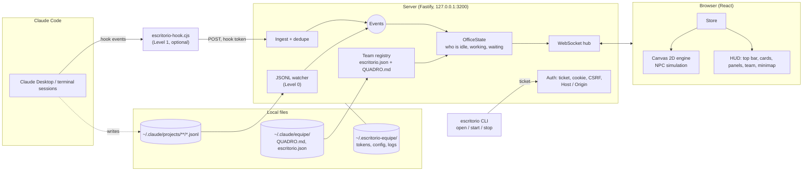
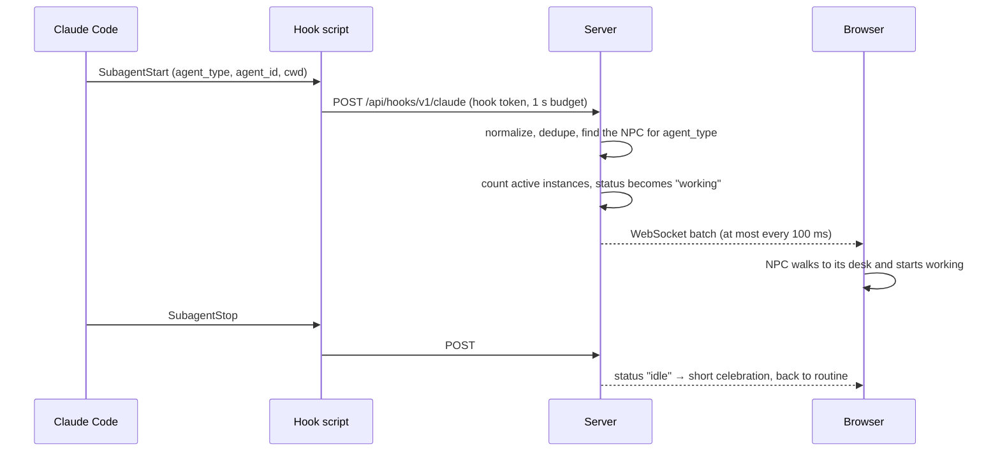

# Architecture

[🇧🇷 Português](../../pt-BR/explanation/architecture.md) · [Documentation index](../README.md)

This page explains how Team Office is put together and why. It describes Phase 1; parts planned for later phases are marked. The detailed internal design (in Portuguese) is [`docs/ARQUITETURA.md`](../../ARQUITETURA.md), and every major decision has an [ADR](../adr/README.md).

## The idea in one paragraph

A small Node server on `127.0.0.1:3200` learns what Claude Code is doing, keeps a live "state of the office" in memory, and pushes it over a WebSocket to a React page that draws the floor on a Canvas and the controls in ordinary HTML. The server is the source of truth for what each agent is doing; the browser only decides how that looks.

## Overview

Planned for later phases and not present yet: the approval broker, the session manager with the terminal (chat with the Director), the project catalogue and `PLANO.md` watcher, the usage and token aggregators.

## Two ways to learn what Claude is doing

| | Level 0 (default) | Level 1 (optional) |
|---|---|---|
| Source | The server watches Claude's session files | A small script (`escritorio-hook.cjs`) runs on each Claude Code event and posts it |
| Touches `settings.json` | No | Yes, with a diff you approve, backup and undo |
| Delay | 1–2 s | about 0.14 s |

Both produce the same normalized event, so the rest of the system does not care where it came from; duplicates are removed. A hook event for a tool carries only names and identifiers.

## From an agent call to a working NPC

- A status is **logical** (server: idle, working, waiting for approval; two parallel calls and one stop still means working) and a behaviour is **visual** (browser: where to walk, which animation). The visual part is pure, seeded code under `src/shared/npc/`, so it is tested without a browser.
- An `agent_type` that is not in the team becomes a temporary Freelancer; a hook or session that fails never blocks Claude Code.

## Layout of the code

| Folder | Role |
|---|---|
| `src/shared/` | Pure TypeScript without I/O: zod contracts, the NPC state machine, A* pathfinding, camera math, text helpers. Used by server, browser and tests. |
| `src/server/` | Fastify server: authentication, hook ingest, JSONL watcher, office state, team registry, settings installer, WebSocket hub. |
| `src/web/` | The page: `engine/` (Canvas), `hud/` (React), `i18n/`, `store/`, `net/`. |
| `src/hook-runtime/` | The hook script, plain `.cjs` with no dependencies and no build, copied to `~/.escritorio-equipe/bin/`. |
| `src/cli/` | The `escritorio` command. |

Principles that shaped it: zero tokens spent by the office; nothing changes in `settings.json` without a diff and your approval; the browser never sends paths or commands; parsers of external data are tolerant and never throw; the simulation is pure and testable; every file write is atomic.

## Stack

Node 26, TypeScript 6, Fastify 5 with `@fastify/websocket`, React 19 with Vite 8, a custom Canvas 2D engine, zod 4 for contracts, Vitest 5 and Playwright 1.65. All versions are pinned exactly in `package.json`. See [ADR-0007](../../adr/0007-stack-and-repository-layout.md).

## Related

- [Local security model](security.md)
- [Why a custom Canvas 2D engine](why-canvas-2d.md)
- [Routes reference](../reference/api.md)
