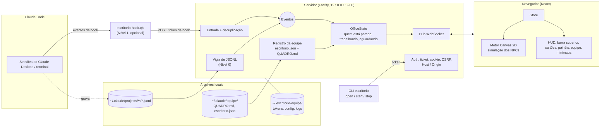
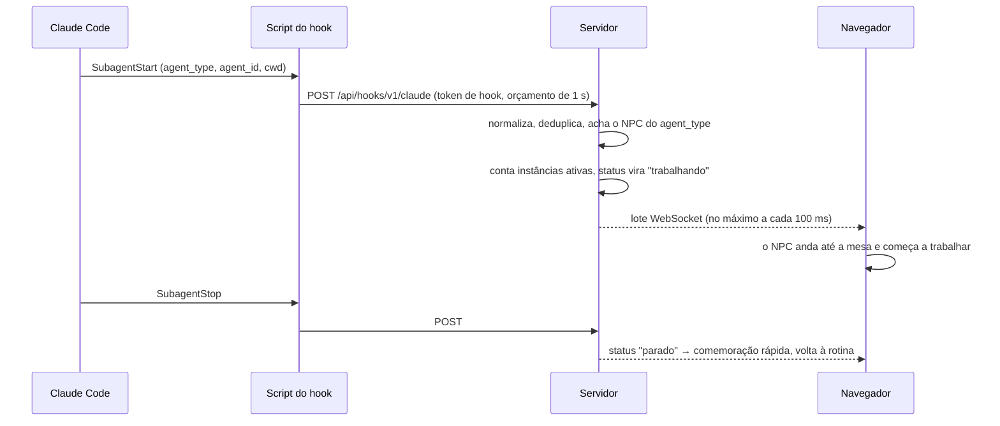

# Arquitetura

[🇺🇸 English](../../en/explanation/architecture.md) · [Índice da documentação](../README.md)

Esta página explica como o Escritório da Equipe é montado e por quê. Ela descreve a Fase 1; o que está planejado para fases futuras vem marcado. O desenho interno detalhado é o [`docs/ARQUITETURA.md`](../../ARQUITETURA.md), e cada decisão importante tem um [ADR](../adr/README.md).

## A ideia em um parágrafo

Um pequeno servidor Node em `127.0.0.1:3200` descobre o que o Claude Code está fazendo, mantém em memória um "estado do escritório" ao vivo e o empurra por WebSocket para uma página React que desenha o andar num Canvas e os controles em HTML comum. O servidor é a fonte da verdade sobre o que cada agente está fazendo; o navegador só decide como isso aparece.

## Visão geral

Previstos para fases futuras e ainda ausentes: o intermediário de aprovações, o gerenciador de sessões com o terminal (chat com o Diretor), o catálogo de projetos e o vigia do `PLANO.md`, os agregadores de uso e de tokens.

## Duas formas de saber o que o Claude está fazendo

| | Nível 0 (padrão) | Nível 1 (opcional) |
|---|---|---|
| Fonte | O servidor vigia os arquivos de sessão do Claude | Um script pequeno (`escritorio-hook.cjs`) roda a cada evento do Claude Code e o envia |
| Toca no `settings.json` | Não | Sim, com um diff que você aprova, backup e desfazer |
| Atraso | 1–2 s | cerca de 0,14 s |

Os dois geram o mesmo evento normalizado, então o resto do sistema não se importa com a origem; duplicatas são removidas. Um evento de hook de ferramenta carrega só nomes e identificadores.

## Da chamada de um agente a um NPC trabalhando

- O status é **lógico** (servidor: parado, trabalhando, aguardando aprovação; duas chamadas em paralelo e uma parada ainda é trabalhando) e o comportamento é **visual** (navegador: para onde andar, qual animação). A parte visual é código puro, com semente, em `src/shared/npc/`, então é testada sem navegador.
- Um `agent_type` que não está na equipe vira um Freelancer temporário; um hook ou sessão que falha nunca trava o Claude Code.

## Organização do código

| Pasta | Papel |
|---|---|
| `src/shared/` | TypeScript puro sem I/O: contratos zod, máquina de estados dos NPCs, pathfinding A*, matemática da câmera, utilitários de texto. Usado por servidor, navegador e testes. |
| `src/server/` | Servidor Fastify: autenticação, entrada de hooks, vigia de JSONL, estado do escritório, registro da equipe, instalador do settings, hub WebSocket. |
| `src/web/` | A página: `engine/` (Canvas), `hud/` (React), `i18n/`, `store/`, `net/`. |
| `src/hook-runtime/` | O script do hook, `.cjs` puro, sem dependências e sem build, copiado para `~/.escritorio-equipe/bin/`. |
| `src/cli/` | O comando `escritorio`. |

Princípios que moldaram tudo: zero tokens gastos pelo escritório; nada muda no `settings.json` sem diff e sem a sua aprovação; o navegador nunca envia caminhos nem comandos; leitores de dados externos são tolerantes e nunca lançam exceção; a simulação é pura e testável; toda gravação de arquivo é atômica.

## Stack

Node 26, TypeScript 6, Fastify 5 com `@fastify/websocket`, React 19 com Vite 8, motor Canvas 2D próprio, zod 4 para contratos, Vitest 5 e Playwright 1.65. Todas as versões estão fixadas exatamente no `package.json`. Veja o [ADR-0007](../../adr/0007-stack-and-repository-layout.md).

## Relacionado

- [Modelo de segurança local](security.md)
- [Por que um motor Canvas 2D próprio](why-canvas-2d.md)
- [Referência de rotas](../reference/api.md)
